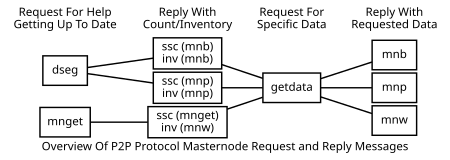

```{eval-rst}
.. meta::
  :title: Masternode Messages
  :description: The following network messages enable the masternode features built in to Dash.
```

# Masternode Messages

The following network messages enable the [masternode](../resources/glossary.md#masternode) features built in to Dash.



For additional details, refer to the Developer Guide [Masternode Sync](../guide/dash-features-masternode-sync.md) and [Masternode Payment](../guide/dash-features-masternode-payment.md) sections.

## ssc

The [`ssc` message](../reference/p2p-network-masternode-messages.md#ssc) is used to track the sync status of masternode objects. This message is sent in response to sync requests for the list of governance objects (`govsync` message), and governance object votes (`govsync` message).

| Bytes | Name | Data type | Required | Description |
| ---------- | ----------- | --------- | -------- | -------- |
| 4 | nItemID | int | Required | Masternode Sync Item ID
| 4 | nCount | int | Required | Number of items to sync

Sync Item IDs

| ID | Description | Response To
|------|--------------|---------------
| 10 | MASTERNODE_SYNC_GOVOBJ | [`govsync` message](../reference/p2p-network-governance-messages.md#govsync)
| 11 | MASTERNODE_SYNC_GOVOBJ_VOTE | [`govsync` message](../reference/p2p-network-governance-messages.md#govsync) with non-zero hash

The following annotated hexdump shows a [`ssc` message](../reference/p2p-network-masternode-messages.md#ssc). (The message header has been omitted.)

``` text
02000000 ................................... Item ID: MASTERNODE_SYNC_LIST (2)
bf110000 ................................... Count: 4543
```

## mnauth

*Added in protocol version 70214*

The [`mnauth` message](../reference/p2p-network-masternode-messages.md#mnauth) is sent by a [masternode](../resources/glossary.md#masternode) immediately after sending a [`verack` message](../reference/p2p-network-control-messages.md#verack) to authenticate that the sender is a masternode. It is only sent when the sender is actually a masternode.

The [`mnauth` message](../reference/p2p-network-masternode-messages.md#mnauth) signs a challenge that was previously sent via a [`version` message](../reference/p2p-network-control-messages.md#version). The challenge is signed differently depending on if the connection is inbound or outbound.

:::{note}
As of protocol version 70218, when communicating with masternodes that have reported a version => `MIN_MASTERNODE_PROTO_VERSION`, the mnauth signature is created by signing a message incorporating both the `mnauth_challenge` and protocol `version` (from the [`version` message](../reference/p2p-network-control-messages.md#version)). Further details may be found in [Dash Core PR 3631](https://github.com/dashpay/dash/pull/3631).
:::

This is primarily used as a DoS protection mechanism to allow persistent connections between masternodes to remain open even if inbound connection limits are reached.

As of Dash Core 23.1.9, a node accepts at most 3 verified inbound connections per ProRegTx hash (`MAX_VERIFIED_INBOUND_PER_PROTX`). Additional inbound connections that authenticate with the same ProRegTx hash are disconnected.

| Bytes | Name | Data type | Description |
| --- | --- | --- | --- |
| 32 | proRegTxHash | uint256 | The hash of the ProRegTx that identifies the masternode
| 96 | sig | byte[] | BLS signature of the [`version` message's](../reference/p2p-network-control-messages.md#version) `mnauth_challenge`. Signed with the operator key of the masternode.<br>**Note**: serialized using the basic BLS scheme after Dash 19.0 activation

The following annotated hexdump shows a [`mnauth` message](../reference/p2p-network-masternode-messages.md#mnauth). (The message header has been omitted.)

``` text
63cd3bf06404d78f80163afeb4b13e18
7dc1c1d04997ef04f1a2ecb3166dd004 ........... ProRegTx Hash

12f2706bc75e9cb14a9ebf1d93d177d5
f266ad2eddc49ad463810cb976a3e4bb
abffc96819c5030fd5a7601af9c8ee50
0feb066b38a48af1a31b7242bd814bab
91e2a887f963904f33af851ddc9167d5
66d6d3bd6c07e99091edd8867d0dd56e ........... Masternode BLS Signature (96 bytes)
```

## platformban

*Added in protocol version 70238 of Dash Core*

The [`platformban` message](../reference/p2p-network-masternode-messages.md#platformban) is used by Dash Platform to request a Proof of Service (PoSe) ban of an [EvoNode](../resources/glossary.md#evolution-masternode-evonode) as described in [DIP31](https://github.com/dashpay/dips/blob/master/dip-0031.md). Platform injects the message by sending it to a Dash Core node, which validates it and relays it to its peers. When quorum PoSe is enabled ([Spork 23](../reference/p2p-network-control-messages.md#spork)), masternodes that accept the message consider the targeted EvoNode to have a bad connection in subsequent DKG sessions until a ProUpServTx for that EvoNode is mined (for example, to revive it after a PoSe ban).

A node only processes the message once its blockchain is synced. The message is accepted only if all of the following are true:

* `protx_hash` identifies an EvoNode in the current masternode list
* `requested_height` is no more than 576 blocks below the current chain tip and not above it
* `quorum_hash` identifies an existing quorum of the network's Platform LLMQ type
* `signature` is a valid threshold signature by that quorum, where the request ID is `hash("PlatformPoSeBan" + protx_hash + requested_height)` and the message hash is `hash(protx_hash + requested_height)`

Valid messages are relayed using an [`inv` message](../reference/p2p-network-data-messages.md#inv) of type `MSG_PLATFORM_BAN` (33). The inventory hash is the hash of the message excluding the `signature` field. Peers request the message with a [`getdata` message](../reference/p2p-network-data-messages.md#getdata) and receive the `platformban` message in response. As of protocol version 70240, the message can use the BIP324 short message ID 168.

| Bytes | Name | Data type | Required | Description |
| ---------- | ----------- | --------- | -------- | -------- |
| 32 | protx_hash | uint256 | Required | The ProRegTx hash of the EvoNode to ban
| 4 | requested_height | int32_t | Required | Block height at which the ban was requested
| 32 | quorum_hash | uint256 | Required | The hash of the Platform quorum that signed the message
| 96 | signature | byte[] | Required | Platform quorum BLS signature<br>**Note**: serialized using the basic BLS scheme
