.. meta::
   :description: This guide describes how to set up a Dash masternode. It also describes various options for hosting and different wallets
   :keywords: dash, guide, masternodes, trezor, dip3, setup, bls

.. _masternode-setup:

================
Masternode Setup
================

Setting up a masternode requires a basic understanding of Linux and
blockchain technology, as well as an ability to follow instructions
closely. It also requires regular maintenance and careful security,
particularly if you are not storing your Dash on a hardware wallet.
There are some decisions to be made along the way, and optional extra
steps to take for increased security.

Commercial :ref:`masternode hosting services <masternode-hosting>` are
available if you prefer to delegate day-to-day operation of your
masternode to a professional operator. When using these hosting
services, you retain full control of the 1000 DASH collateral and pay an
agreed percentage of your reward to the operator. It is also possible to
delegate your voting keys to a representative, see the 
:ref:`governance documentation <delegating-votes>` for more
information.

Before you begin
================

This guide assumes you are setting up a single mainnet masternode for
the first time. If you are updating a masternode, see  :ref:`here
<masternode-update>` instead. You will need:

- 1000 Dash
- A wallet to store your Dash, preferably a hardware wallet, although 
  Dash Core wallet is also supported
- A Linux server, preferably a Virtual Private Server (VPS)

For information about hosted masternodes, see the documentation listed below:

- :ref:`Information for users of hosted masternodes <hosted-setup>`
- :ref:`Information for operators of hosted masternodes <operator-transactions>`

This documentation describes the commands as if they were entered in the Dash
Core GUI by opening the console from **Window > Console**, but the same result
can be achieved on a masternode by entering the same commands and adding the
prefix ``~/.dashcore/dash-cli`` to each command.

Server configuration
--------------------

Proper server configuration is essential to successful masternode operation for
both security and performance reasons. Refer to the :hoverxref:`Server configuration
<server-config>` page for details on preparing your server to host a masternode.

Send the collateral
===================

A Dash address with a single unspent transaction output (UTXO) of exactly 1000
DASH is required to operate a masternode. Once it has been sent, various keys
regarding the transaction must be extracted for later entry in a configuration
file and registration transaction as proof to write the configuration to the
blockchain so the masternode can be included in the deterministic list.

A masternode can be registered from a hardware wallet, the official Dash Core
wallet, or a Dash Electrum wallet, although a hardware wallet is highly
recommended to enhance security and protect yourself against hacking. This guide
will describe the steps for both hardware wallets and Dash Core.

.. note::

  Details of registering a masternode with Dash Electrum can be found on the
  :ref:`Electrum - Advanced Functions page <electrum-masternodes>`.

.. tip::

  If you plan to register your masternode with the :ref:`Dash Core
  registration wizard <dashcore-mn-wizard>`, you do not need to send the
  collateral in advance. The wizard can send the collateral from your wallet to
  a new address and register the masternode in a single transaction.

Option 1: Sending from a hardware wallet
----------------------------------------

Set up your Trezor using the Trezor wallet at https://wallet.trezor.io/
and send a test transaction to verify that it is working properly. For
help on this, see :ref:`this guide <hardware-trezor>` - you may also
choose to (carefully!) `add a passphrase <https://blog.trezor.io/passphrase-the-ultimate-protection-for-your-accounts-3a311990925b>`_
to your Trezor to further protect your collateral. Create a new account
in your Trezor wallet by clicking **Add account**. Then click the
**Receive** tab and send exactly 1000 DASH to the address displayed. If
you are setting up multiple masternodes, send 1000 DASH to consecutive
addresses within the same new account. You should see the transaction as
soon as the first confirmation arrives, usually within a few minutes.

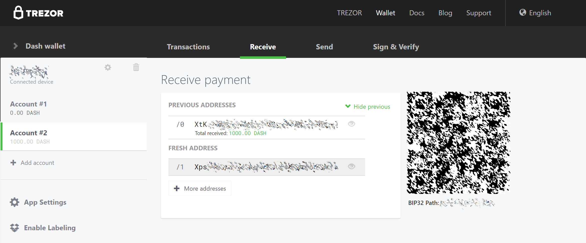

   Wallet Receive tab showing successfully received collateral of
   1000 DASH

Once the transaction appears, click the QR code on the right to view the
transaction on the blockchain. Keep this window open as we complete the
following steps, since we will soon need to confirm that 15
confirmations exist, as shown in the following screenshot.

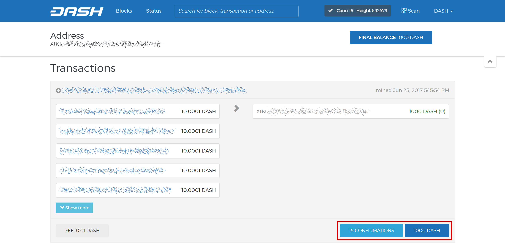

   Blockchain explorer showing 15 confirmations for collateral
   transfer

While we are waiting for 15 confirmations, download the latest version
of the Dash Masternode Tool (DMT) from the GitHub releases page `here
<https://github.com/Bertrand256/dash-masternode-tool/releases>`__. Unzip
and run the file. The following window appears.

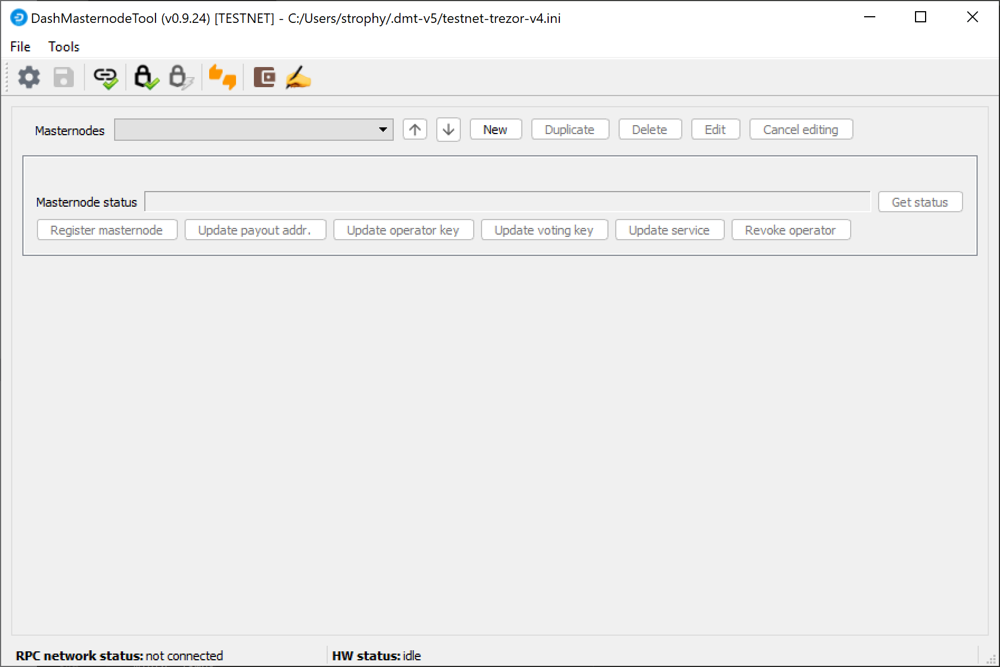

   Dash Masternode Tool startup screen

Click the third button from the left **Check Dash Network Connection**
in the top left corner of the main window to verify that the connection
is working. Then connect your Trezor device and click the next button
**Test Hardware Wallet Connection** to verify the hardware wallet connection
is working.

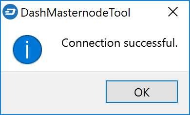

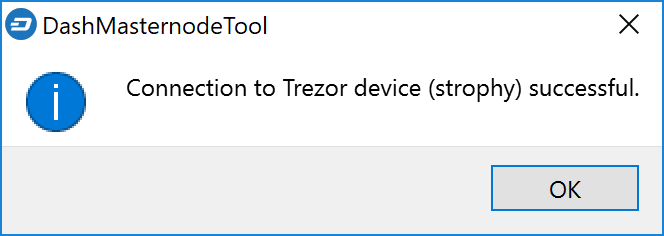

   Dash Masternode Tool successful connection confirmations

We will now use DMT to enter some basic information about the masternode
and extract the transaction ID. Carry out the following sequence of
steps as shown in this screenshot:

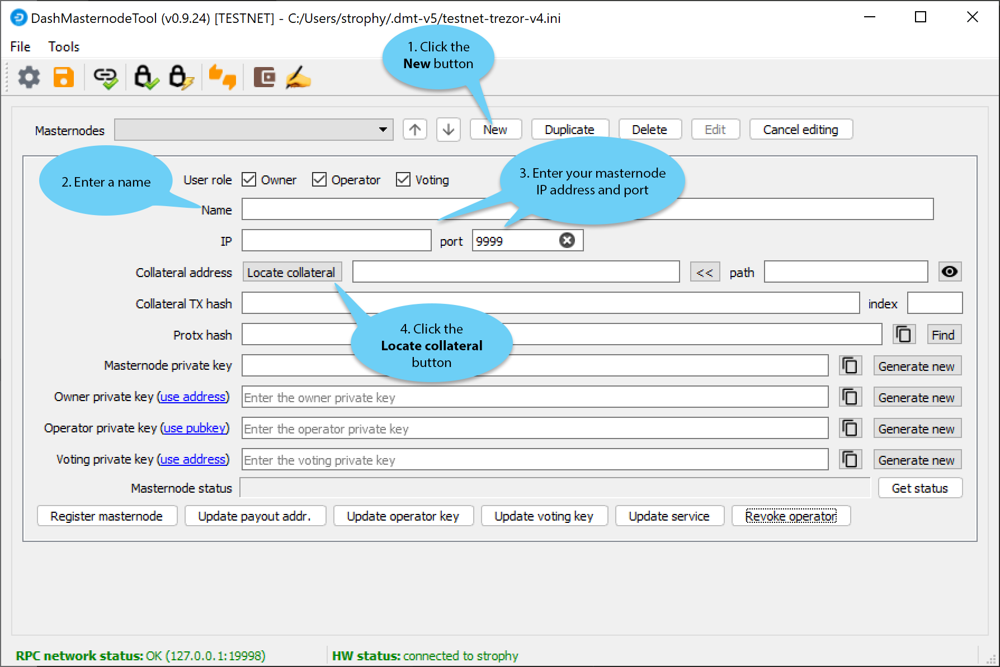

   Dash Masternode Tool configuration steps

#. Click the **New** button.
#. Enter a name for your masternode. The host name you specified 
   for your VPS above is a good choice.
#. Enter the IP address of your masternode. This was given to you
   by the VPS provider when you set up the server. Then enter the TCP 
   port number. This should be 9999.
#. Click **Locate collateral** to view unused collateral funding 
   transactions available on the connected hardware wallet. Select the 
   address to which you sent 1000 Dash and click **Apply**. The 
   **Collateral address**, **path**, **Collateral TX hash** and
   **index** fields should be filled automatically.

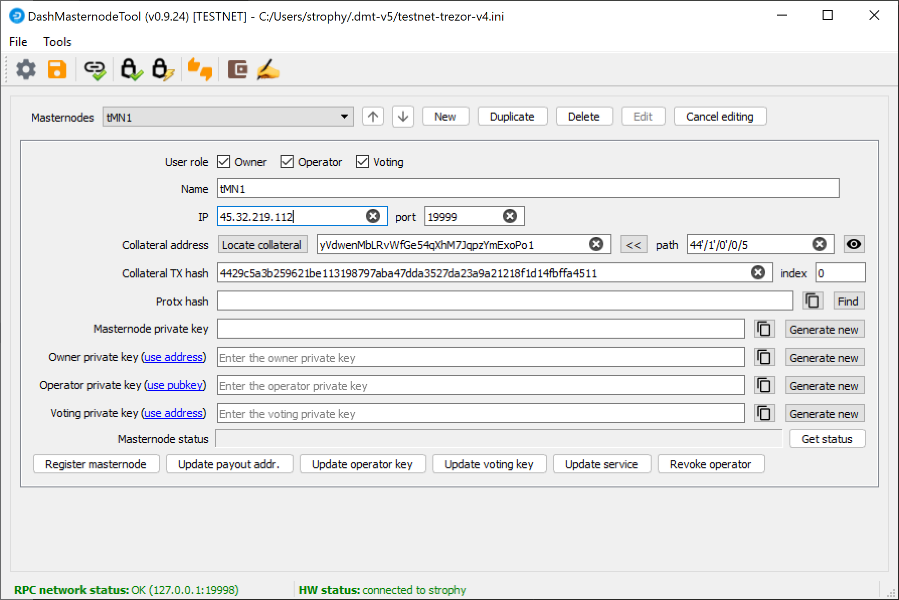

   Dash Masternode Tool with masternode configuration

Leave DMT open and continue with the next step: :ref:`installing Dash
Core on your VPS <masternode-setup-install-dashcore>`.

Option 2: Sending from Dash Core wallet
---------------------------------------

Open Dash Core wallet and wait for it to synchronize with the network.
It should look like this when ready:

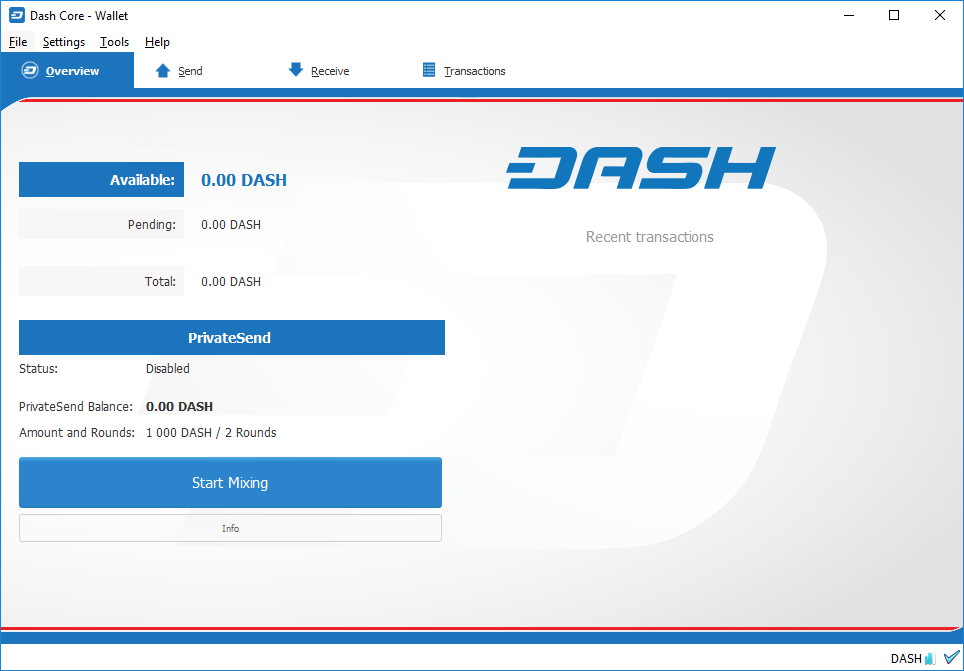

   Fully synchronized Dash Core wallet

Click **Window > Console** to open the console. Type the following
command into the console to generate a new Dash address for the
collateral::

  getnewaddress
  yiFfzbwiN9oneftd7cEfr3kQLRwQ4kp7ue

Take note of the collateral address, since we will need it later.  The
next step is to secure your wallet (if you have not already done so).
First, encrypt the wallet by selecting **Settings > Encrypt wallet**.
You should use a strong, new password that you have never used somewhere
else. Take note of your password and store it somewhere safe or you will
be permanently locked out of your wallet and lose access to your funds.
Next, back up your wallet file by selecting **File > Backup Wallet**.
Save the file to a secure location physically separate to your computer,
since this will be the only way you can access our funds if anything
happens to your computer. For more details on these steps, see
:ref:`here <dashcore-backup>`.

Now send exactly 1000 DASH in a single transaction to the new address
you generated in the previous step. This may be sent from another
wallet, or from funds already held in your current wallet. Once the
transaction is complete, view the transaction in a `blockchain explorer
<https://insight.dash.org/insight/>`_ by searching for the address. You
will need 15 confirmations before you can register the masternode, but
you can continue with the next step at this point already: generating
your masternode operator key.

   Blockchain explorer showing 15 confirmations for collateral
   transfer

.. _masternode-setup-install-dashcore:

Install Dash Core
=================

Dash Core is the software behind both the Dash Core GUI wallet and Dash
masternodes. If not displaying a GUI, it runs as a daemon on your VPS
(dashd), controlled by a simple command interface (dash-cli).

Open PuTTY or a console again and connect using the username and
password you just created for your new, non-root user. The following
options are available for installing a Dash masternode:

- Manual installation (this guide)
- `xkcd's installation guide <https://www.dash.org/forum/threads/system-wide-masternode-setup-with-systemd-auto-re-start-rfc.39460/>`__

Manual installation
-----------------------------

To manually download and install the components of your Dash masternode,
visit the `GitHub releases page <https://github.com/dashpay/dash/releases/latest>`_ 
and copy the link to the latest ``x86_64-linux-gnu`` version. Go back to
your terminal window and enter the following command, pasting in the
address to the latest version of Dash Core by right clicking or pressing
**Ctrl + V**::

  cd /tmp
  wget https://github.com/dashpay/dash/releases/download/v23.1.10/dashcore-23.1.10-x86_64-linux-gnu.tar.gz

Verify the authenticity of your download by checking its detached
signature against the public key published by the Dash Core development
team. All releases of Dash since 0.16.0 are signed using GPG with the
following key:

- Pasta (pasta) with the key ``5252 7BED ABE8 7984``, `verifiable on Keybase
  <https://keybase.io/pasta>`__ (`download <https://keybase.io/pasta/pgp_keys.asc>`__)

::

  curl https://keybase.io/pasta/pgp_keys.asc | gpg --import
  wget https://github.com/dashpay/dash/releases/download/v23.1.10/dashcore-23.1.10-x86_64-linux-gnu.tar.gz.asc
  gpg --verify dashcore-23.1.10-x86_64-linux-gnu.tar.gz.asc dashcore-23.1.10-x86_64-linux-gnu.tar.gz

Create a working directory for Dash, extract the compressed archive and
copy the necessary files to the directory::

  mkdir ~/.dashcore
  tar xfv dashcore-23.1.10-x86_64-linux-gnu.tar.gz
  cp -f dashcore-23.1.10/bin/dashd ~/.dashcore/
  cp -f dashcore-23.1.10/bin/dash-cli ~/.dashcore/

Create a configuration file using the following command::

  nano ~/.dashcore/dash.conf

An editor window will appear. We now need to create a configuration file
specifying several variables. Copy and paste the following text to get
started, then replace the variables specific to your configuration as
follows::

  #----
  rpcuser=XXXXXXXXXXXXX
  rpcpassword=XXXXXXXXXXXXXXXXXXXXXXXXXXXX
  rpcallowip=127.0.0.1
  #----
  listen=1
  server=1
  daemon=1
  #----
  #masternodeblsprivkey=
  externalip=XXX.XXX.XXX.XXX
  #----

Replace the fields marked with ``XXXXXXX`` as follows:

- ``rpcuser``: enter any string of numbers or letters, no special
  characters allowed
- ``rpcpassword``: enter any string of numbers or letters, no special
  characters allowed
- ``externalip``: this is the IP address of your VPS

Leave the ``masternodeblsprivkey`` field commented out for now. The
result should look something like this:

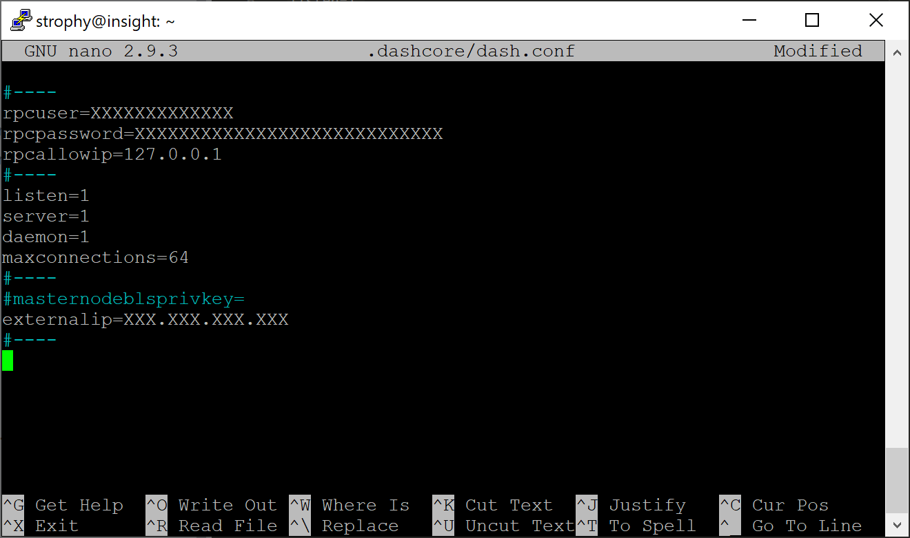

   Entering key data in dash.conf on the masternode

Press **Ctrl + X** to close the editor and **Y** and **Enter** save the
file. You can now start running Dash on the masternode to begin
synchronization with the blockchain::

  ~/.dashcore/dashd

You will see a message reading **Dash Core server starting**. 

Add dashd to crontab to make sure it runs every minute to check on your
masternode::

  crontab -e

Choose nano as your editor and enter the following line at the end of
the file::

  * * * * * pidof dashd || ~/.dashcore/dashd

Press enter to make sure there is a blank line at the end of the file,
then press **Ctrl + X** to close the editor and **Y** and **Enter** save
the file. We now need to wait for 15 confirmations of the collateral
transaction to complete, and wait for the blockchain to finish
synchronizing on the masternode. You can use the following commands to
monitor progress::

  ~/.dashcore/dash-cli mnsync status

When synchronisation is complete, you should see the following
response::

  {
    "AssetID": 999,
    "AssetName": "MASTERNODE_SYNC_FINISHED",
    "AssetStartTime": 1558596597,
    "Attempt": 0,
    "IsBlockchainSynced": true,
    "IsSynced": true,
    "IsFailed": false
  }

Continue with the next step to construct the ProTx transaction required
to enable your masternode.

.. _register-masternode:

Register your masternode
========================

The three keys required for the different masternode roles are described briefly
under :ref:`mn-concepts` in this documentation.

Option 1: Registering from a hardware wallet
--------------------------------------------

Go back to DMT and ensure that all fields from the previous step are
still filled out correctly.  Click **Generate new** for the three
private keys required for a masternode:

- Owner private key
- Operator private key
- Voting private key

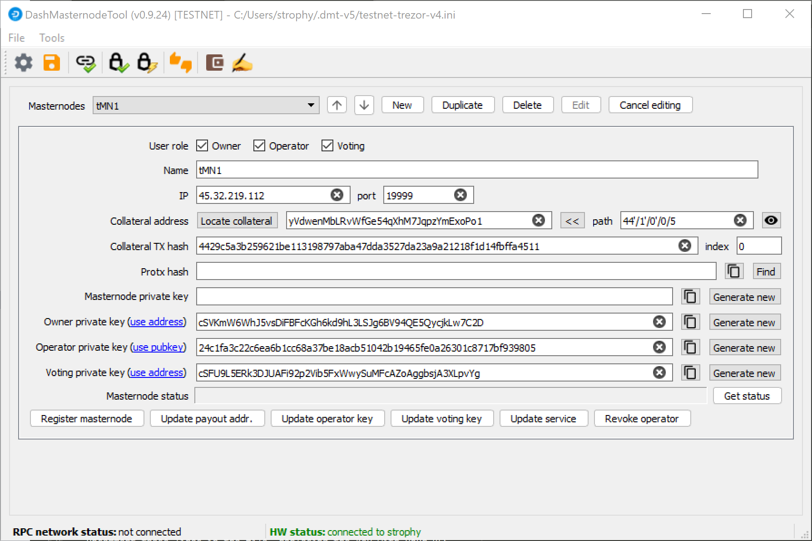

   Dash Masternode Tool ready to register a new masternode

Then click **Register masternode**. Optionally specify a different
**Payout address** and/or **Operator reward**, then click **Continue**.
Select **Remote Dash RPC Node (automatic method)**. (See `here <https://github.com/Bertrand256/dash-masternode-tool/blob/master/doc/config-connection-direct.md>`__ 
for documentation on using your own local RPC node.) and confirm the
following two messages:

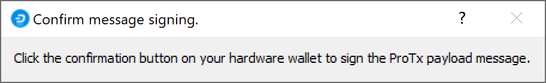

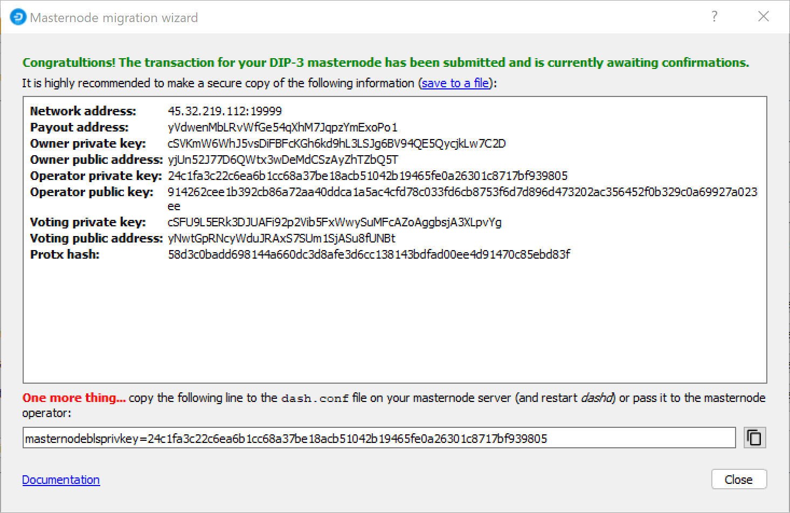

   Dash Masternode Tool confirmation dialogs to register a masternode

The BLS private key must be entered in the ``dash.conf`` file on the
masternode. This allows the masternode to watch the blockchain for
relevant Pro*Tx transactions, and will cause it to start serving as a
masternode when the signed ProRegTx is broadcast by the owner, as we
just did above. Log in to your masternode using ``ssh`` or PuTTY and
edit the configuration file as follows::

  nano ~/.dashcore/dash.conf

The editor appears with the existing masternode configuration. Add or
uncomment this lines in the file, replacing the key with your BLS
private key generated above::

  masternodeblsprivkey=24c1fa3c22c6ea6b1cc68a37be18acb51042b19465fe0a26301c8717bf939805

Press enter to make sure there is a blank line at the end of the file,
then press **Ctrl + X** to close the editor and **Y** and **Enter** save
the file. Note that providing a ``masternodeblsprivkey`` enables
masternode mode, which will automatically force the ``txindex=1``,
``peerbloomfilters=1``, and ``prune=0`` settings necessary to provide
masternode service. We now need to restart the masternode for this
change to take effect. Enter the following commands, waiting a few
seconds in between to give Dash Core time to shut down::

  ~/.dashcore/dash-cli stop
  sleep 15
  ~/.dashcore/dashd

At this point you can monitor your masternode by entering
``~/.dashcore/dash-cli masternode status`` or using the **Get status**
function in DMT. The final result should appear as follows:

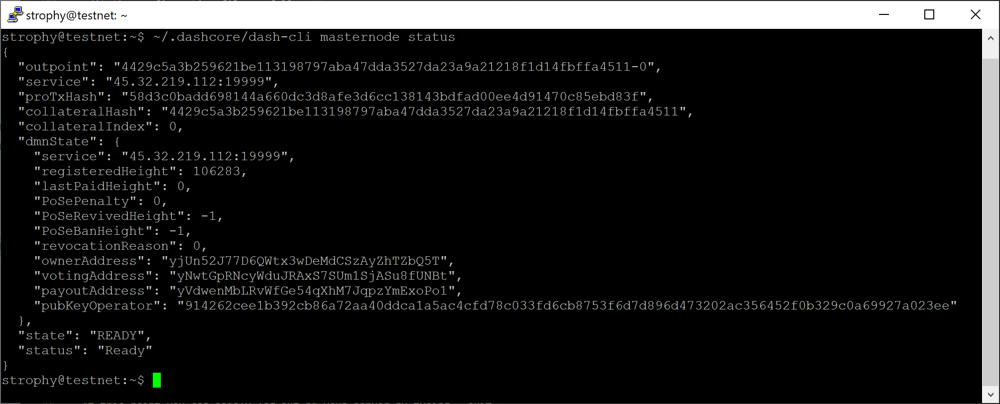

   dash-cli masternode status output showing successfully registered masternode

At this point you can safely log out of your server by typing ``exit``.
Congratulations! Your masternode is now running.

.. _dashcore-mn-wizard:

Option 2: Registering with the Dash Core wizard
-----------------------------------------------

Starting with Dash Core v24.0.0, you can register a masternode or evonode
directly from the **Masternodes** tab of the Dash Core wallet using the
**Register Masternode…** wizard. The wizard can fund the collateral, generate
the operator key and submit the provider registration transaction (ProRegTx) for
you, without any console commands.

Before you start
^^^^^^^^^^^^^^^^

- Open Dash Core wallet and wait for it to synchronize with the network.
- If the **Masternodes** tab is not visible, enable it by selecting **Settings >
  Options**, opening the **Display** tab and checking **Show Masternodes Tab**.
- The wallet must hold private keys. The **Register Masternode…** button is
  disabled for watch-only wallets and for wallets that use an external signer.
  Hover over the button to see the reason if it is disabled.
- Make sure the wallet holds enough funds. If the wizard sends the collateral,
  a single address in your wallet must hold the full collateral amount (1000
  DASH for a masternode, 4000 DASH for an evonode) plus the transaction fee.
  Otherwise, you only need a small balance to pay the transaction fee.
- If your wallet is encrypted, you will be asked to unlock it when the
  registration is prepared and sent.

To start the wizard, open the **Masternodes** tab and click **Register
Masternode…**. The wizard shows your progress at the top of each page. Click
**Next** to continue or **Back** to return to an earlier page.

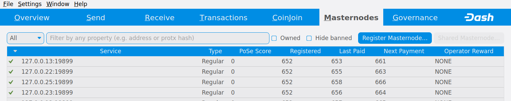

   Masternodes tab showing the Register Masternode… button

Masternode type
^^^^^^^^^^^^^^^

Select **Masternode** to register a regular masternode or **EvoNode** to
register an evonode. Evonodes also host Dash Platform and require additional
information later in the wizard. See the :ref:`evonode setup guide
<evonode-setup>` for details on preparing an evonode server.

Collateral
^^^^^^^^^^

Select how the collateral will be provided:

- **Send collateral from this wallet to a new address**: A single transaction
  sends the collateral to a new address in this wallet and registers the
  masternode. A new address is filled in automatically. Click **Use new
  address** to generate another one.
- **Use an existing collateral output of this wallet**: Select an output from
  the list. Only unspent P2PKH outputs of exactly the collateral amount that
  have at least one confirmation, are not locked and are not already used by
  another masternode are shown. If your collateral output is locked in Coin
  Control, unlock it first.
- **Reference an external collateral (e.g. hardware wallet)**: Enter the
  **Transaction ID** and **Output index** of the collateral transaction held
  outside this wallet. You will be asked to sign a message with the collateral
  key before the registration is submitted.

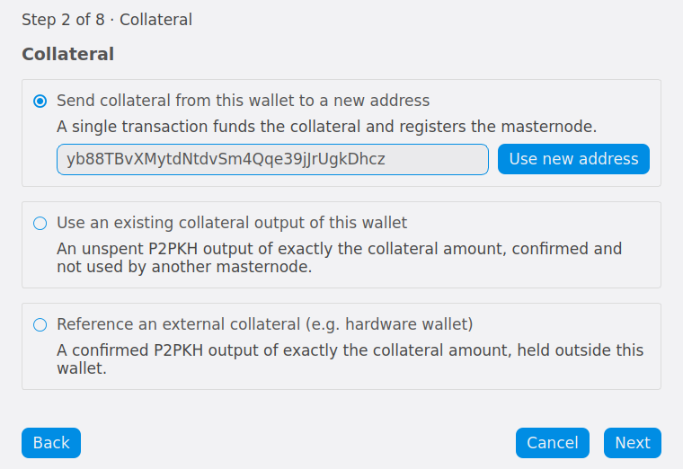

   Collateral page of the Register Masternode wizard

Service addresses
^^^^^^^^^^^^^^^^^

Enter the public IP address and port of your masternode server, for example
``45.76.230.239:9999``. Separate multiple addresses with commas or spaces.
Multiple addresses can only be registered after the v24 hard fork activates, and
the first address must be an IPv4 address. This
field may be left empty, but the masternode then stays inactive until you send
an :ref:`Update Service <dashcore-mn-maintenance>` transaction with an address.

Keys
^^^^

- **Owner address**: Controls the masternode and signs registrar updates. A new
  address from this wallet is filled in automatically. You can also enter an
  address controlled by the owner.
- **Voting address**: Used to vote on governance proposals. Leave it empty to
  vote with the owner key, click **Use new address** to keep a separate voting
  key in this wallet, or enter the address of your :ref:`voting delegate
  <delegating-votes>`.
- **Operator key**: Select **Generate a new operator key** to create a new BLS
  key pair, or **Use an existing operator public key** if your hosting provider
  gave you their BLS public key. A generated secret key is shown later and must
  be confirmed before registering.

The owner and voting addresses must be different from the collateral address.

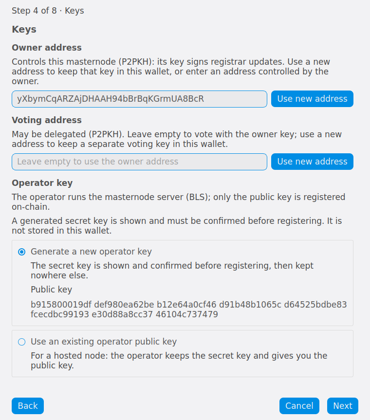

   Keys page of the Register Masternode wizard

Payout
^^^^^^

Enter the **Payout address** that will receive the owner's masternode rewards. A
new address is filled in automatically. The payout address must be different
from the owner, voting and collateral addresses. Optionally set an **Operator
reward** percentage if you have an agreement with a hosting provider. Leave it
at 0 otherwise, since the operator will permanently receive this share of all
rewards of the masternode. The operator specifies their own payout address in a
separate :ref:`Update Service <dip3-update-service>` transaction.

Platform services (evonodes only)
^^^^^^^^^^^^^^^^^^^^^^^^^^^^^^^^^

If you selected **EvoNode**, enter the **Platform node ID** (40 hexadecimal
characters), which is derived from the Platform P2P key. See
:ref:`evonode-generate-platform-node-id` for instructions on generating it.
Then enter the **Platform P2P** and **Platform HTTPS API** addresses in the
``ADDR:PORT`` format. Before the v24 hard fork activates, only the **Platform P2P
port** and **Platform HTTPS port** can be registered instead.

Fee source
^^^^^^^^^^

Select the wallet address that pays the transaction fee. If the wizard is
sending the collateral, the selected address also funds the collateral and
change returns to this address. The exact fee is calculated from your wallet
settings when you register.

Review
^^^^^^

Check the summary of all values carefully. If anything is wrong, click **Back**
to correct it. Then click **Continue** (if you generated a new operator key),
**Register**, or **Prepare** (if you referenced an external collateral).

Save operator key
^^^^^^^^^^^^^^^^^

If you generated a new operator key, the wizard now shows the **Operator secret
key** and the line to add to the ``dash.conf`` file on your masternode server.
Click **Copy** and store the line somewhere safe. **This key is not stored in
the wallet and cannot be recovered.** Type the last 4 characters of the secret
key to confirm you saved it, then click **Register** (or **Prepare** for an
external collateral).

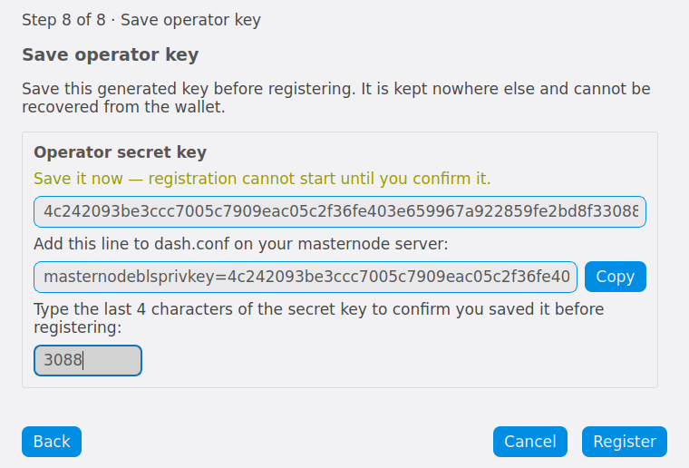

   Save operator key page of the Register Masternode wizard

Prove collateral ownership (external collateral only)
^^^^^^^^^^^^^^^^^^^^^^^^^^^^^^^^^^^^^^^^^^^^^^^^^^^^^

If you referenced an external collateral, the wizard prepares the registration
and shows the collateral address and a message. Click **Copy message** and sign
the message with the private key of the collateral address, for example with
your hardware wallet's sign-message feature. Paste the base64 signature into the
**Signature** field and click **Submit**.

The registration cannot be changed at this point, so the **Back** button is not
available. If you click **Cancel**, the prepared registration is discarded.

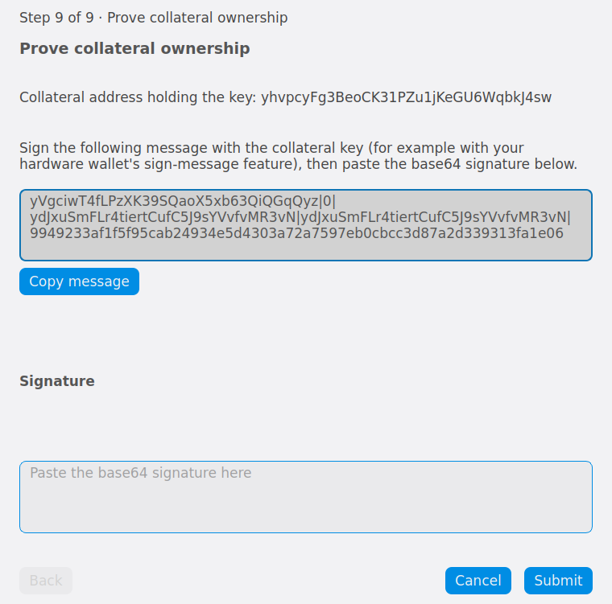

   Prove collateral ownership page of the Register Masternode wizard

After you click **Register** (or **Submit** for an external collateral), a
**Confirm masternode registration** dialog summarizes the transaction. Click
**Send** to broadcast it, then unlock the wallet if prompted.

Masternode registered
^^^^^^^^^^^^^^^^^^^^^

The final page shows the **Provider transaction hash** (proTxHash) that
identifies your masternode, along with a list of next steps. The transaction
appears in the **Transactions** tab as **Masternode Registration**. Click
**Finish** to close the wizard.

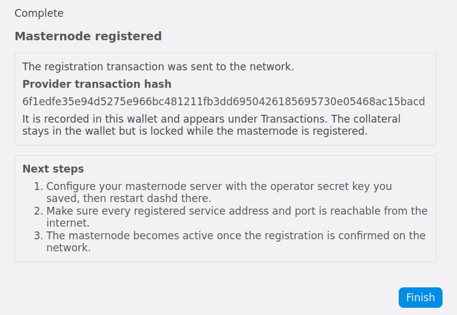

   Masternode registered page of the Register Masternode wizard

.. _dashcore-mn-wizard-configure:

Configure the masternode server
^^^^^^^^^^^^^^^^^^^^^^^^^^^^^^^

If you used an operator public key provided by your hosting service, they
configure the server for you. If you generated a new operator key, the operator
secret key must now be entered on your masternode server.

For a regular masternode, log in to your masternode using ``ssh`` or PuTTY and
edit the configuration file as follows::

  nano ~/.dashcore/dash.conf

Add the ``masternodeblsprivkey=`` line you saved in the wizard, then save the
file and restart Dash Core::

  ~/.dashcore/dash-cli stop
  sleep 15
  ~/.dashcore/dashd

Make sure every registered service address and port is reachable from the
internet. The masternode becomes active once the registration is confirmed on
the network. You can monitor it by entering ``~/.dashcore/dash-cli masternode
status``.

For an evonode, run ``dashmate setup`` on your server as described in
:ref:`Complete server configuration <evonode-complete-server-config>`. Select
**Yes** when asked whether the masternode is already registered, and enter the
operator secret key from the wizard as the BLS private key along with your
Platform node key. The Platform node key must match the Platform node ID you
registered.

.. _dashcore-protx:

Option 3: Registering from Dash Core console
--------------------------------------------

Identify the funding transaction
^^^^^^^^^^^^^^^^^^^^^^^^^^^^^^^^

If you used an address in Dash Core wallet for your collateral
transaction, you now need to find the txid of the transaction. Click
**Window > Console** and enter the following command::

  masternode outputs

This should return a string of characters similar to the following::

  {
  "16347a28f4e5edf39f4dceac60e2327931a25fdee1fb4b94b63eeacf0d5879e3-1",
  }

The first long string is your ``collateralHash``, while the last number
is the ``collateralIndex``. 

.. _bls-generation:

Generate a BLS key pair
^^^^^^^^^^^^^^^^^^^^^^^

A public/private BLS key pair is required to operate a masternode. The
private key is specified on the masternode itself, and allows it to be
included in the deterministic masternode list once a provider
registration transaction with the corresponding public key has been
created.

If you are using a hosting service, they may provide you with their
public key, and you can skip this step. If you are hosting your own
masternode or have agreed to provide your host with the BLS private key,
generate a BLS public/private keypair in Dash Core by clicking **Tools >
Console** and entering the following command::

  bls generate

  {
    "secret": "395555d67d884364f9e37e7e1b29536519b74af2e5ff7b62122e62c2fffab35e",
    "public": "99f20ed1538e28259ff80044982372519a2e6e4cdedb01c96f8f22e755b2b3124fbeebdf6de3587189cf44b3c6e7670e",
    "scheme": "legacy"
  }

**These keys are NOT stored by the wallet and must be kept secure,
similar to the value provided in the past by the** ``masternode genkey``
**command.**

Add the private key to your masternode configuration
^^^^^^^^^^^^^^^^^^^^^^^^^^^^^^^^^^^^^^^^^^^^^^^^^^^^

The public key will be used in following steps. The private key must be
entered in the ``dash.conf`` file on the masternode. This allows the
masternode to watch the blockchain for relevant Pro*Tx transactions, and
will cause it to start serving as a masternode when the signed ProRegTx
is broadcast by the owner (final step below). Log in to your masternode
using ``ssh`` or PuTTY and edit the configuration file as follows::

  nano ~/.dashcore/dash.conf

The editor appears with the existing masternode configuration. Add or
uncomment this line in the file, replacing the key with your BLS private
key generated above::

  masternodeblsprivkey=395555d67d884364f9e37e7e1b29536519b74af2e5ff7b62122e62c2fffab35e

Press enter to make sure there is a blank line at the end of the file,
then press **Ctrl + X** to close the editor and **Y** and **Enter** save
the file. Note that providing a ``masternodeblsprivkey`` enables
masternode mode, which will automatically force the ``txindex=1``,
``peerbloomfilters=1``, and ``prune=0`` settings necessary to provide
masternode service. We now need to restart the masternode for this
change to take effect. Enter the following commands, waiting a few
seconds in between to give Dash Core time to shut down::

  ~/.dashcore/dash-cli stop
  sleep 15
  ~/.dashcore/dashd

We will now prepare the transaction used to register the masternode on
the network.

Prepare a ProRegTx transaction
^^^^^^^^^^^^^^^^^^^^^^^^^^^^^^

A pair of BLS keys for the operator were already generated above, and
the private key was entered on the masternode. The public key is used in
this transaction as the ``operatorPubKey``.

First, we need to get a new, unused address from the wallet to serve as
the **owner key address** (``ownerKeyAddr``). This is not the same as
the collateral address holding 1000 Dash. Generate a new address as
follows::

  getnewaddress

  yfgxFhqrdDG15ZWKJAN6dQvn6dZdgBPAip

This address can also be used as the **voting key address**
(``votingKeyAddr``). Alternatively, you can specify an address provided
to you by your chosen voting delegate, or simply generate a new voting
key address as follows::

  getnewaddress

  yfRaZN8c3Erpqj9iKnmQ9QDBeUuRhWV3Mg

Then either generate or choose an existing address to receive the
**owner's masternode payouts** (``payoutAddress``). It is also possible
to use an address external to the wallet::

  getnewaddress

  yjZVt49WsQd6XSrPVAUGXtJccxviH9ZQpN

You can also optionally generate and fund another address as the
**transaction fee source** (``feeSourceAddress``). If you selected an
external payout address, you must specify a fee source address. 

Either the payout address or fee source address must have enough balance
to pay the transaction fee, or the ``register_prepare`` transaction will
fail.

The private keys to the owner and fee source addresses must exist in the
wallet submitting the transaction to the network. If your wallet is
protected by a password, it must now be unlocked to perform the
following commands. Unlock your wallet for 5 minutes::

  walletpassphrase yourSecretPassword 300

We will now prepare an unsigned ProRegTx special transaction using the
``protx register_prepare`` command. This command has the following
syntax::

  protx register_prepare collateralHash collateralIndex coreP2PAddrs ownerKeyAddr 
    operatorPubKey votingKeyAddr operatorReward payoutAddress (feeSourceAddress)

.. warning::
  Previously, ``protx register_prepare_legacy`` could be used to register a masternode with a legacy
  scheme BLS key. The legacy commands were deprecated as of Dash Core v23.0, so it is now recommended
  to generate a new basic scheme BLS key instead. This can be done by following the :ref:`Generate a
  BLS key pair <bls-generation>` instructions.

Open a text editor such as notepad to prepare this command. Replace each
argument to the command as follows:

.. note::
  
  As of Dash Core v23.0, the ``coreP2PAddrs`` field accepts backwards-compatible input.

- ``collateralHash``: The txid of the 1000 Dash collateral funding transaction
- ``collateralIndex``: The output index of the 1000 Dash funding transaction
- ``coreP2PAddrs``: Array of masternode address(es), in the format ``x.x.x.x:yyyy``
- ``ownerKeyAddr``: The new Dash address generated above for the owner/voting address
- ``operatorPubKey``: The BLS public key generated above (or provided by your hosting service)
- ``votingKeyAddr``: The new Dash address generated above, or the address of a delegate, used for
  proposal voting
- ``operatorReward``: The percentage of the block reward allocated to the operator as payment
- ``payoutAddress``: A new or existing Dash address to receive the owner's masternode rewards
- ``feeSourceAddress``: An (optional) address used to fund ProTx fee. ``payoutAddress`` will be used
  if not specified.

Note that the operator is responsible for :ref:`specifying their own
reward <dip3-update-service>` address in a separate ``update_service``
transaction if you specify a non-zero ``operatorReward``. The owner of
the masternode collateral does not specify the operator's payout
address.

Example (remove line breaks if copying)::

  protx register_prepare 
    16347a28f4e5edf39f4dceac60e2327931a25fdee1fb4b94b63eeacf0d5879e3 
    1 
    '["45.76.230.239:19999"]' 
    yfgxFhqrdDG15ZWKJAN6dQvn6dZdgBPAip 
    99f20ed1538e28259ff80044982372519a2e6e4cdedb01c96f8f22e755b2b3124fbeebdf6de3587189cf44b3c6e7670e 
    yfRaZN8c3Erpqj9iKnmQ9QDBeUuRhWV3Mg 
    0 
    yjZVt49WsQd6XSrPVAUGXtJccxviH9ZQpN 
    yR83WsikBaBaNusTnHZf28kAcL8oVmp1TE

Output::

  {
    "tx": "030001000175c9d23c2710798ef0788e6a4d609460586a20e91a15f2097f56fc6e007c4f8e0000000000feffffff01a1949800000000001976a91434b09363474b14d02739a327fe76e6ea12deecad88ac00000000d1010000000000e379580dcfea3eb6944bfbe1de5fa2317932e260acce4d9ff3ede5f4287a34160100000000000000000000000000ffff2d4ce6ef4e1fd47babdb9092489c82426623299dde76b9c72d9799f20ed1538e28259ff80044982372519a2e6e4cdedb01c96f8f22e755b2b3124fbeebdf6de3587189cf44b3c6e7670ed1935246865dce1accce6c8691c8466bd67ebf1200001976a914fef33f56f709ba6b08d073932f925afedaa3700488acfdb281e134504145b5f8c7bd7b47fd241f3b7ea1f97ebf382249f601a0187f5300",
    "collateralAddress": "yjSPYvgUiAQ9AFj5tKFA8thFLoLBUxQERb",
    "signMessage": "yjZVt49WsQd6XSrPVAUGXtJccxviH9ZQpN|0|yfgxFhqrdDG15ZWKJAN6dQvn6dZdgBPAip|yfRaZN8c3Erpqj9iKnmQ9QDBeUuRhWV3Mg|ad5f82257bd00a5a1cb5da1a44a6eb8899cf096d3748d68b8ea6d6b10046a28e"
  }

Next we will use the ``collateralAddress`` and ``signMessage`` fields to
sign the transaction, and the output of the ``tx`` field to submit the
transaction.

Sign the ProRegTx transaction
^^^^^^^^^^^^^^^^^^^^^^^^^^^^^

We will now sign the content of the ``signMessage`` field using the
private key for the collateral address as specified in
``collateralAddress``. Note that no internet connection is required for
this step, meaning that the wallet can remain disconnected from the
internet in cold storage to sign the message. In this example we will
again use Dash Core, but it is equally possible to use the signing
function of a hardware wallet. The command takes the following syntax::

  signmessage collateralAddress signMessage

Example::

  signmessage yjSPYvgUiAQ9AFj5tKFA8thFLoLBUxQERb yjZVt49WsQd6XSrPVAUGXtJccxviH9ZQpN|0|yfgxFhqrdDG15ZWKJAN6dQvn6dZdgBPAip|yfRaZN8c3Erpqj9iKnmQ9QDBeUuRhWV3Mg|ad5f82257bd00a5a1cb5da1a44a6eb8899cf096d3748d68b8ea6d6b10046a28e

Output::

  II8JvEBMj6I3Ws8wqxh0bXVds6Ny+7h5HAQhqmd5r/0lWBCpsxMJHJT3KBcZ23oUZtsa6gjgISf+a8GzJg1BfEg=

Submit the signed message
^^^^^^^^^^^^^^^^^^^^^^^^^

We will now submit the ProRegTx special transaction to the blockchain to
register the masternode. This command must be sent from a Dash Core
wallet holding a balance on either the ``feeSourceAddress`` or
``payoutAddress``, since a standard transaction fee is involved. The
command takes the following syntax::

  protx register_submit tx sig

Where: 

- ``tx``: The serialized transaction previously returned in the ``tx`` 
  output field from the ``protx register_prepare`` command
- ``sig``: The message signed with the collateral key from the 
  ``signmessage`` command

Example::

  protx register_submit 030001000175c9d23c2710798ef0788e6a4d609460586a20e91a15f2097f56fc6e007c4f8e0000000000feffffff01a1949800000000001976a91434b09363474b14d02739a327fe76e6ea12deecad88ac00000000d1010000000000e379580dcfea3eb6944bfbe1de5fa2317932e260acce4d9ff3ede5f4287a34160100000000000000000000000000ffff2d4ce6ef4e1fd47babdb9092489c82426623299dde76b9c72d9799f20ed1538e28259ff80044982372519a2e6e4cdedb01c96f8f22e755b2b3124fbeebdf6de3587189cf44b3c6e7670ed1935246865dce1accce6c8691c8466bd67ebf1200001976a914fef33f56f709ba6b08d073932f925afedaa3700488acfdb281e134504145b5f8c7bd7b47fd241f3b7ea1f97ebf382249f601a0187f5300 II8JvEBMj6I3Ws8wqxh0bXVds6Ny+7h5HAQhqmd5r/0lWBCpsxMJHJT3KBcZ23oUZtsa6gjgISf+a8GzJg1BfEg=

Output::

  aba8c22f8992d78fd4ff0c94cb19a5c30e62e7587ee43d5285296a4e6e5af062

Your masternode is now registered and will appear on the Deterministic
Masternode List after the transaction is mined to a block. You can view
this list on the **Masternodes -> DIP3 Masternodes** tab of the Dash
Core wallet, or in the console using the command ``protx list valid``,
where the txid of the final ``protx register_submit`` transaction
identifies your masternode.

At this point you can go back to your terminal window and monitor your
masternode by entering ``~/.dashcore/dash-cli masternode status`` or
using the **Get status** function in DMT. 

At this point you can safely log out of your server by typing ``exit``.
Congratulations! Your masternode is now running.

.. _dashelectrum-protx:

Option 4: Registering from Dash Electrum wallet
-----------------------------------------------

Dash Electrum supports registering and managing masternodes. Details can be
found on the :ref:`Electrum - Advanced Functions page <electrum-masternodes>`.
If combined with Electrum's :ref:`multisig features <electrum-multisig>` the
masternode collateral can be stored in a multisig wallet for increased security
flexibility.

.. warning::
  Always exercise caution when using multisig accounts and verify that each
  mnemonic is backed up appropriately. See `this page
  <https://github.com/dashpay/docs/blob/master/wallets/electrum/dip3_p2sh_howto.md>`_
  for the Dash Electrum documentation demonstrating how to configure a
  masternode using a multisig collateral.
  

.. _shared-masternode-setup:

Register a shared masternode
============================

Starting with Dash Core v24.0.0, between two and eight participants can fund
the collateral of one regular masternode together using the **Shared
Masternode…** wizard on the **Masternodes** tab. Each participant contributes at
least 100 DASH, and the contributions must add up to exactly 1000 DASH. The
owner reward is split between the participants in proportion to their
contributions, after any operator reward has been paid.

.. note::

  Shared masternodes require the v24 hard fork. The **Shared Masternode…**
  button is disabled until the hard fork is active on the network. Evonodes
  cannot use shared collateral yet.

One person acts as the **coordinator** and enters the participants, masternode
settings and exit terms. Everyone else is a **participant** who pastes the
messages they receive and copies back a reply. Messages can be exchanged using
any channel, either as text copied to the clipboard or as files saved with
**Save…** and opened with **Open File…**. Nothing reaches the network until the
coordinator broadcasts the final registration. Every message shows a short code
so the coordinator and participants can confirm they hold the same message.
Replies are accepted in any order, and either role can save a session and
reopen it later from the **Shared Masternode…** landing page.

The registration is completed in three rounds:

#. **Invitation**: The coordinator sends one invitation to every participant.
   Each participant reserves their coins and replies with their details.
#. **Locked terms**: The coordinator locks the terms and sends them to every
   participant. Each participant reviews the terms and replies with their
   approval.
#. **Signing request**: The coordinator sends a signing request. Each
   participant replies with their signed contribution, and the coordinator
   broadcasts the registration.

Coordinator steps
-----------------

#. Open the **Masternodes** tab, click **Shared Masternode…** and then click
   **Start a Shared Masternode**.
#. On the **Participants** page, enter a name and amount for each participant
   (two rows are provided; click **Add Participant** for more, up to eight), and
   select your own row in the **Me** column.
#. On the **Masternode settings** page, enter the **Service addresses**, the
   **Operator key**, the name of the participant who runs the node in **Node
   run by**, the **Voting address** and an optional **Operator reward**. These
   settings apply to the whole masternode.
#. On the **Exit terms** page, select the **Early period** and the
   **Early-exit penalty**. Anyone can dissolve the masternode on their own at
   any time, and everyone gets their principal back. During the early period,
   whoever dissolves alone pays the penalty out of their own share and it is
   split among the others. If everyone agrees, dissolving is free at any time.
   The penalty must be less than the smallest share.
#. On the **Your contribution** page, enter your **Owner address**, **Refund
   address** and optional **Reward address**, then click **Reserve Coins**. The
   refund address receives your principal when the masternode is dissolved and
   cannot be changed later.
#. If you generated a new operator key, save it on the **Save operator key**
   page and confirm it by typing its last 4 characters.
#. On the **Invite participants** page, click **Copy Invitation** or **Save
   Invitation…** and send the invitation to every participant. Click **Paste**
   to add each reply as it arrives. When every participant has replied, click
   **Lock Terms**, review the terms shown, and click **Lock and Approve**. This
   locks the terms and approves them with your owner key.
#. On the **Approvals** page, click **Copy Locked Terms** and send them to every
   participant. Paste each approval as it arrives. When all approvals are in,
   Dash Core signs your coins and opens the **Signatures** page. If you released
   your coins in the meantime, click **Reserve and Sign** to continue.
#. On the **Signatures** page, click **Copy Signing Request** and send it to
   every participant. Paste each signed contribution as it arrives, then click
   **Broadcast Registration**.

Participant steps
-----------------

#. Open the **Masternodes** tab, click **Shared Masternode…** and click **Paste
   From Clipboard** or **Open File…** to open the invitation you received.
#. On the **Your share** page, select your row in **This is me:**, enter your
   **Owner address**, **Refund address** and optional **Reward address**, and
   check the coins the wallet will use for your share. Click **Reserve Coins and
   Copy Details** and send the reply to the coordinator.
#. When you receive the locked terms, click **Paste** to open them. Check that
   your share has the correct amount and addresses, then click **Approve and
   Copy Reply** and send the reply to the coordinator.
#. When you receive the signing request, paste it, click **Sign and Copy
   Reply** and send the reply to the coordinator.
#. Wait for the coordinator to broadcast the registration.

If you need to withdraw before the registration is broadcast, click **Release
my coins** to release the coins reserved for your share. Reserved coins are
released automatically after the registration is broadcast.

After the registration
----------------------

The **Shared masternode registered** page lists what to keep safe: your share
owner key, the operator secret key (if you hold it), a standby dissolution and
the session record. Click **Save Final Record…** to save the session record.
The masternode appears in the list on the **Masternodes** tab with the type
**Shared (you hold k of n)** after one confirmation. Once the registration is
confirmed, create a standby dissolution as described in
:ref:`shared-masternode-maintenance` and store it with your refund address
backup, separately from your wallet.

The participant who runs the node must configure the operator secret key on the
masternode server as described in :ref:`Configure the masternode server
<dashcore-mn-wizard-configure>`.
