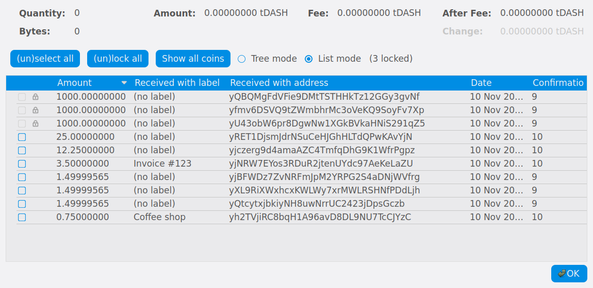
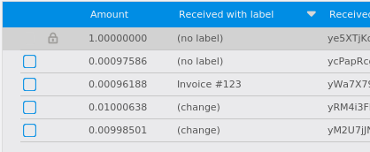
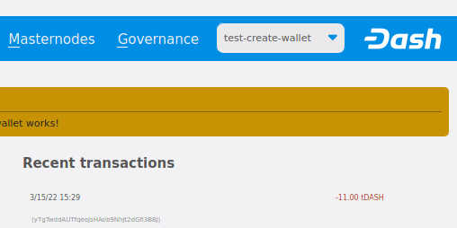
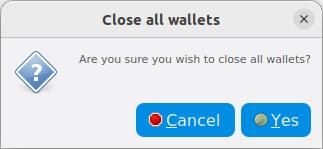
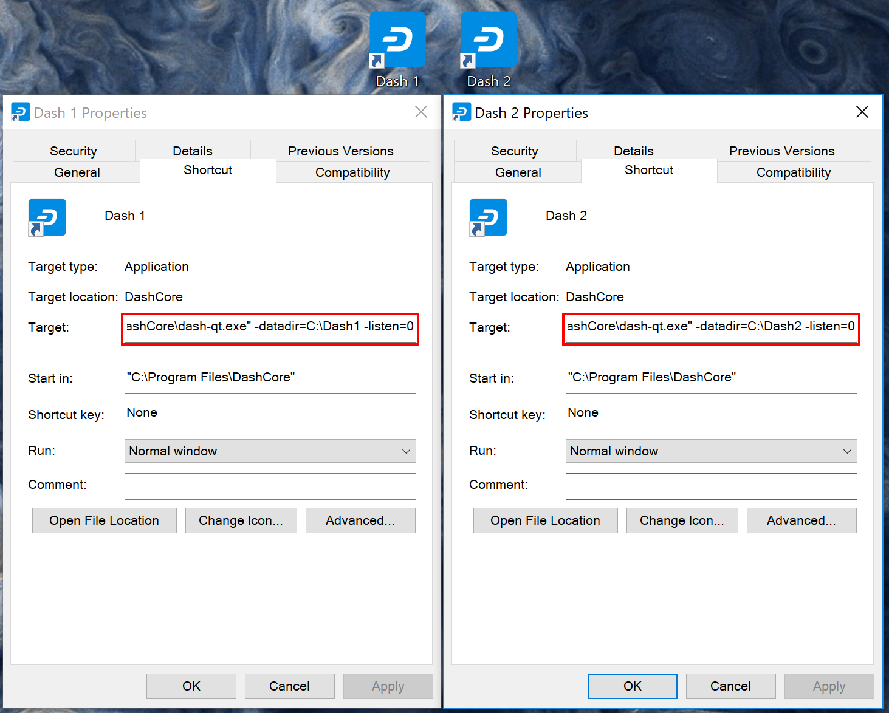
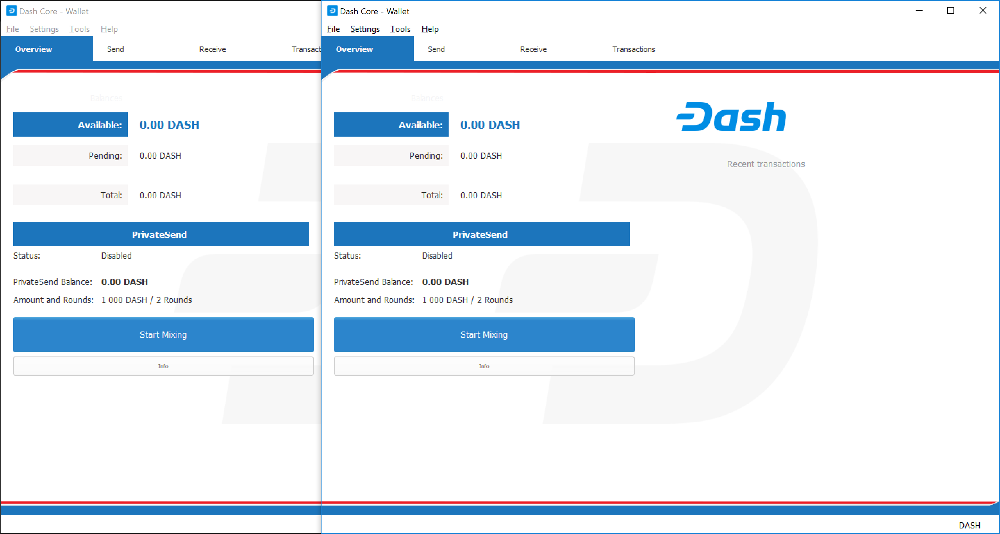

.. meta::
   :description: Coin control, HD wallets, multisig, multiple wallet files using the Dash Core wallet
   :keywords: dash, core, wallet, backup, restore, wallet.dat, multisig, hd, seed, passphrase, mnemonic, coin control, hierarchical deterministic

.. _dashcore-advanced:

===============
Advanced topics
===============

.. _coin-control:

Coin Control
============

Coin Control allows users of the Dash Core Wallet to specify which
addresses and Unspent Transaction Outputs (UTXOs) should be used as
inputs in transactions. This allows you to keep a specific balance on
certain addresses in your wallet, while spending others freely. In Dash
Core Wallet, click **Settings > Options > Wallet > Enable coin control
features**. Now, when you go to the Send tab in your wallet, a new
button labelled **Inputs…** will appear. Click this button to select
which UTXOs can be used as input for any transactions you create. The
following window appears:

   Coin Selection window in Dash Core wallet, showing two masternodes
   (testnet)

Right click on the transaction(s) you do not want to spend, then select
**Lock unspent**. A small lock will appear next to the transaction. You
can click the **(un)lock all** button to lock all listed UTXOs. If any
listed UTXOs are already locked, the button unlocks them instead. The
button works in both tree mode and list mode. When you are ready to
continue, click **OK**. You
can now safely create transactions with your remaining funds without
affecting the locked UTXOs.

.. figure:: img/coin-selection-lock.png
   :width: 220px

   Locking UTXOs in Dash Core wallet

.. _dashcore-testnet:

Running Dash Testnet
====================

It is recommended to run Dash Core on testnet for your experimentations. 
To start on testnet via the command line, do the following:

For Linux::

  ./dash-qt -testnet

For Mac (run from Applications/Dash-Qt.app/Contents/MacOS)::

  Dash-Qt -testnet

Note: You may need to allow an app from an unknown developer before running this. 
Cmd+Click on the application and click **Open**.

Now, open Mac Terminal and run::

  cd /Applications/Dash-Qt.app/Contents/MacOS
  ./Dash-Qt -testnet

You may top up your testnet wallet by `accessing the faucet <http://faucet.testnet.networks.dash.org/>`_.

.. _dashcore-hd:

HD Wallets
==========

.. versionadded:: v20.1.0
   
   HD wallets are now created by default.

Dash Core includes an implementation of BIP39/BIP44 compatible hierarchical
deterministic (HD) key generation.

.. _dashcore-hd-upgrade:

Upgrade to HD
-------------

.. warning::

  A new :ref:`backup <dashcore-backup>` must be created after upgrading to an HD
  wallet.

Dash Core includes the ability upgrade a legacy non-hierarchical deterministic
(HD) wallet to an HD wallet via the ``upgradetohd`` command. The command can be
run by either opening the console from **Window > Console** or issuing the
following RPC command from ``dash-cli``::

  upgradetohd "" "" <walletpassphrase>

If your wallet is already encrypted you must enter the passphrase as the third
parameter to the command. If your wallet is not already encrypted, specifying a
wallet passphrase will trigger wallet encryption.

To see full details for the command, run the following from either the console
or ``dash-cli``::

  help upgradetohd

View HD wallet information
--------------------------

To view the recovery phrase (BIP39 mnemonic) of the active wallet, click
**Settings > Show Recovery Phrase…**. If the wallet is encrypted, you will be
asked to enter your wallet passphrase first.

You can also open the console from **Window > Console** or issue the following
RPC command from ``dash-cli`` to view the mnemonic seed. If the wallet is
encrypted, unlock it with ``walletpassphrase`` first::

  listdescriptors true

Dash Core will display the BIP39 mnemonic in the ``mnemonic`` field of the
wallet's descriptors. It will also display the mnemonic passphrase in the
``mnemonicpassphrase`` field if one was used when creating the wallet. For a
legacy wallet, use ``dumphdinfo`` instead, which displays the HD seed in both
hexadecimal and BIP39 mnemonic formats.

.. _dashcore-hd-restore:

Restore HD wallet
-----------------

To restore an existing HD wallet, or define your own separately generated
mnemonic and/or passphrase, create a new blank wallet with following command::

  createwallet "enter wallet name" false true "optional wallet password"

Add the HD wallet details to the newly created wallet by running::

  upgradetohd "enter mnemonic" "optional mnemonic passphrase" "optional wallet passphrase"

The HD wallet will be restored and your balance will appear once sync is
complete.

Note that the wallet passphrase is different to the mnemonic passphrase, which
is often also referred to as the "25th word" or "extension word". The wallet
passphrase encrypts the wallet file itself, while the mnemonic passphrase is
used to specify different derivation branches from the same mnemonic seed.

The mnemonic passphrase can be at most 248 bytes long. To restore a wallet
that was created with a longer mnemonic passphrase (up to 256 bytes), start
Dash Core with the ``-allow-deprecated-long-mnemonics`` option. This only
works for wallets created by Dash Core 19.2.0 or later.

.. _dashcore-hd-default:

Enable HD Wallet Creation By Default
------------------------------------

.. versionadded:: v20.1.0
   
  HD wallets are now created by default without requiring the steps listed below.

Prior to Dash Core v20.1.0, it was necessary to complete theses steps to make HD
wallet the default. We will use the Windows GUI wallet in this example, but the
commands are similar if using ``dash-qt`` or ``dashd`` on other operating
systems. Enter the following command to configure Dash Core to generate HD
wallets by default::

  dash-qt.exe -usehd

To make this configuration persist between restarts, add ``usehd=1`` to the
``dash.conf`` file.

.. _dashcore-multisig:

Multisignature
==============

This section presents a worked example to demonstrate multisig
functionality in Dash Core. Some address formats or RPC responses may
differ slightly from the version shown here, but the principle and
commands are the same. The example demonstrates how to set up a 2-of-3
multisig address and spend from it using a partially signed transaction
(PSBT), so that each party only shares public keys and signs with their
own wallet. The example parties involved are a buyer, a seller and an
arbiter. This example is based on:

- https://gist.github.com/jashmenn/9811198
- https://gist.github.com/gavinandresen/3966071

Step 1: Create three addresses
------------------------------

Seller::

  seller@dash:~$ ./dash-cli getnewaddress seller
  yep4BUesW2zD2RV9QwTrxyxSwTWuVanreh
  
  seller@dash:~$ ./dash-cli getaddressinfo yep4BUesW2zD2RV9QwTrxyxSwTWuVanreh
  {
    "address": "yep4BUesW2zD2RV9QwTrxyxSwTWuVanreh",
    "scriptPubKey": "76a914cadb67ac525bcbcc146ca92d12c69ad782bf7ce488ac",
    "ismine": true,
    "solvable": true,
    "desc": "pkh([95da92f9/44h/1h/0h/0/0]03ca5a0fe994e92c78dd42460e45f8c389639a255b7bd6b9fdf572852d9d5cfbef)#qvsnp4mv",
    "parent_desc": "pkh([95da92f9/44h/1h/0h]tpubDDcXZSVSEUTA64WDJrK2LwvchZUsv9NaB5ZtDQhXTPfUuoTwSktwNfeqcEppzxt61xzuoHab9Ejf3xGih3skJJcbQjcKxNUuRDTSUJ44j8p/0/*)#28z5cny0",
    "iswatchonly": false,
    "isscript": false,
    "pubkey": "03ca5a0fe994e92c78dd42460e45f8c389639a255b7bd6b9fdf572852d9d5cfbef",
    "iscompressed": true,
    "ischange": false,
    "timestamp": 1794954770,
    "hdkeypath": "m/44h/1h/0h/0/0",
    "hdmasterfingerprint": "95da92f9",
    "labels": [
      "seller"
    ]
  }

Buyer::

  buyer@dash:~$ ./dash-cli getnewaddress buyer
  yUxgrQEBcZkEdmQA2bFHfwHHZrpkHL54mE
  
  buyer@dash:~$ ./dash-cli getaddressinfo yUxgrQEBcZkEdmQA2bFHfwHHZrpkHL54mE
  {
    "address": "yUxgrQEBcZkEdmQA2bFHfwHHZrpkHL54mE",
    "scriptPubKey": "76a9145ecc16192070d5ada77ab2d1864d8fda0b3394dc88ac",
    "ismine": true,
    "solvable": true,
    "desc": "pkh([0d1f2523/44h/1h/0h/0/0]021b2d7f9ab010be5f25f631c1182267dcef87162af43d52ef87f4574002880cb5)#v45x5j9q",
    "parent_desc": "pkh([0d1f2523/44h/1h/0h]tpubDCG7VbJRhs6n6gXNZWbvcRqgzYa7Nr8JQHeNznVauPuGiybKyY8MB4F1tUMAMoiGWJsonmgTwysrpUyJa29tWumwPKszyQmTjRTB7m5N6C8/0/*)#fvezqy7r",
    "iswatchonly": false,
    "isscript": false,
    "pubkey": "021b2d7f9ab010be5f25f631c1182267dcef87162af43d52ef87f4574002880cb5",
    "iscompressed": true,
    "ischange": false,
    "timestamp": 1794954771,
    "hdkeypath": "m/44h/1h/0h/0/0",
    "hdmasterfingerprint": "0d1f2523",
    "labels": [
      "buyer"
    ]
  }

Arbiter::

  arbiter@dash:~$ ./dash-cli getnewaddress arbiter
  yWkmi3htqzJYGYvozxDr9Sk9AAvVEQPqPt
  
  arbiter@dash:~$ ./dash-cli getaddressinfo yWkmi3htqzJYGYvozxDr9Sk9AAvVEQPqPt
  {
    "address": "yWkmi3htqzJYGYvozxDr9Sk9AAvVEQPqPt",
    "scriptPubKey": "76a914727b66603171ae6442194c010aac857c5a20babe88ac",
    "ismine": true,
    "solvable": true,
    "desc": "pkh([44da79bf/44h/1h/0h/0/0]03b4f23cf24c8993d1fcaeca3ece8ba76349d3bd2e5ee5b127231fc8e83593fb0e)#nrkehyx0",
    "parent_desc": "pkh([44da79bf/44h/1h/0h]tpubDD1f6iys5Bx4zBimuS37eMnUL1oBXyZ1SGPxqHbSYzqQAeCFnBTwhBS4cbL9j5BJPnFAcaorSSAZopCA5HVgtSj9L4GSUWXTwoJkND8w3Fv/0/*)#43lkp399",
    "iswatchonly": false,
    "isscript": false,
    "pubkey": "03b4f23cf24c8993d1fcaeca3ece8ba76349d3bd2e5ee5b127231fc8e83593fb0e",
    "iscompressed": true,
    "ischange": false,
    "timestamp": 1794954771,
    "hdkeypath": "m/44h/1h/0h/0/0",
    "hdmasterfingerprint": "44da79bf",
    "labels": [
      "arbiter"
    ]
  }

This results in three public keys::

  seller:    03ca5a0fe994e92c78dd42460e45f8c389639a255b7bd6b9fdf572852d9d5cfbef
  buyer:     021b2d7f9ab010be5f25f631c1182267dcef87162af43d52ef87f4574002880cb5
  arbiter:   03b4f23cf24c8993d1fcaeca3ece8ba76349d3bd2e5ee5b127231fc8e83593fb0e

Step 2: Create multisig address 
-------------------------------

The ``createmultisig`` command takes as variables the number n
signatures of m keys (supplied as json array) required. In this example,
2 of 3 keys are required to sign the transaction.

Note: The address can be created by anyone, as long as the public keys
and their sequence are known (resulting address and redeemScript are
identical, see below).

Seller::

  seller@dash:~$ ./dash-cli createmultisig 2 '["03ca5a0fe994e92c78dd42460e45f8c389639a255b7bd6b9fdf572852d9d5cfbef","021b2d7f9ab010be5f25f631c1182267dcef87162af43d52ef87f4574002880cb5","03b4f23cf24c8993d1fcaeca3ece8ba76349d3bd2e5ee5b127231fc8e83593fb0e"]'
  {
    "address": "8ojvonkf7536jJW2X5tytr8QuzpAzBjkCx",
    "redeemScript": "522103ca5a0fe994e92c78dd42460e45f8c389639a255b7bd6b9fdf572852d9d5cfbef21021b2d7f9ab010be5f25f631c1182267dcef87162af43d52ef87f4574002880cb52103b4f23cf24c8993d1fcaeca3ece8ba76349d3bd2e5ee5b127231fc8e83593fb0e53ae",
    "descriptor": "sh(multi(2,03ca5a0fe994e92c78dd42460e45f8c389639a255b7bd6b9fdf572852d9d5cfbef,021b2d7f9ab010be5f25f631c1182267dcef87162af43d52ef87f4574002880cb5,03b4f23cf24c8993d1fcaeca3ece8ba76349d3bd2e5ee5b127231fc8e83593fb0e))#sfgj429d"
  }

Buyer::

  buyer@dash:~$ ./dash-cli createmultisig 2 '["03ca5a0fe994e92c78dd42460e45f8c389639a255b7bd6b9fdf572852d9d5cfbef","021b2d7f9ab010be5f25f631c1182267dcef87162af43d52ef87f4574002880cb5","03b4f23cf24c8993d1fcaeca3ece8ba76349d3bd2e5ee5b127231fc8e83593fb0e"]'
  {
    "address": "8ojvonkf7536jJW2X5tytr8QuzpAzBjkCx",
    "redeemScript": "522103ca5a0fe994e92c78dd42460e45f8c389639a255b7bd6b9fdf572852d9d5cfbef21021b2d7f9ab010be5f25f631c1182267dcef87162af43d52ef87f4574002880cb52103b4f23cf24c8993d1fcaeca3ece8ba76349d3bd2e5ee5b127231fc8e83593fb0e53ae",
    "descriptor": "sh(multi(2,03ca5a0fe994e92c78dd42460e45f8c389639a255b7bd6b9fdf572852d9d5cfbef,021b2d7f9ab010be5f25f631c1182267dcef87162af43d52ef87f4574002880cb5,03b4f23cf24c8993d1fcaeca3ece8ba76349d3bd2e5ee5b127231fc8e83593fb0e))#sfgj429d"
  }

Arbiter::

  arbiter@dash:~$ ./dash-cli createmultisig 2 '["03ca5a0fe994e92c78dd42460e45f8c389639a255b7bd6b9fdf572852d9d5cfbef","021b2d7f9ab010be5f25f631c1182267dcef87162af43d52ef87f4574002880cb5","03b4f23cf24c8993d1fcaeca3ece8ba76349d3bd2e5ee5b127231fc8e83593fb0e"]'
  {
    "address": "8ojvonkf7536jJW2X5tytr8QuzpAzBjkCx",
    "redeemScript": "522103ca5a0fe994e92c78dd42460e45f8c389639a255b7bd6b9fdf572852d9d5cfbef21021b2d7f9ab010be5f25f631c1182267dcef87162af43d52ef87f4574002880cb52103b4f23cf24c8993d1fcaeca3ece8ba76349d3bd2e5ee5b127231fc8e83593fb0e53ae",
    "descriptor": "sh(multi(2,03ca5a0fe994e92c78dd42460e45f8c389639a255b7bd6b9fdf572852d9d5cfbef,021b2d7f9ab010be5f25f631c1182267dcef87162af43d52ef87f4574002880cb5,03b4f23cf24c8993d1fcaeca3ece8ba76349d3bd2e5ee5b127231fc8e83593fb0e))#sfgj429d"
  }

Step 3: Buyer funds the multisig address
----------------------------------------

This works the same as a usual transaction.

Buyer::

  buyer@dash:~$ ./dash-cli sendtoaddress 8ojvonkf7536jJW2X5tytr8QuzpAzBjkCx 0.25
  faa6e43c98fefbadcff73bb4417125706d27bf3e11c9903c02e1a7eacaf11233

The seller/arbiter can trace the transaction by its txid in the block
explorer. Or from the console as follows.

Seller::

  seller@dash:~$ ./dash-cli getrawtransaction faa6e43c98fefbadcff73bb4417125706d27bf3e11c9903c02e1a7eacaf11233 1
  {
    "txid": "faa6e43c98fefbadcff73bb4417125706d27bf3e11c9903c02e1a7eacaf11233",
    "version": 2,
    "type": 0,
    "size": 223,
    "locktime": 110,
    [...]
    "vout": [
      {
        "value": 0.25000000,
        "valueSat": 25000000,
        "n": 0,
        "scriptPubKey": {
          "asm": "OP_HASH160 66373d80314490375d948b6fd2bee74865df9bd8 OP_EQUAL",
          "desc": "addr(8ojvonkf7536jJW2X5tytr8QuzpAzBjkCx)#ncq8ygr4",
          "hex": "a91466373d80314490375d948b6fd2bee74865df9bd887",
          "address": "8ojvonkf7536jJW2X5tytr8QuzpAzBjkCx",
          "type": "scripthash"
        }
      },
      {
        "value": 499.74999777,
        "valueSat": 49974999777,
        "n": 1,
        "scriptPubKey": {
          "asm": "OP_DUP OP_HASH160 dc0360231cf766ee4501844d72663bf92d59d97a OP_EQUALVERIFY OP_CHECKSIG",
          "desc": "addr(ygNmYwbS5hZjS4S1GFhs97gjf7PZyNcXDK)#sfvcgypq",
          "hex": "76a914dc0360231cf766ee4501844d72663bf92d59d97a88ac",
          "address": "ygNmYwbS5hZjS4S1GFhs97gjf7PZyNcXDK",
          "type": "pubkeyhash"
        }
      }
    ],
    [...]
    "blockhash": "675860327c6cb72e2d7febc8c380c27e7bc94299c6e120d1c0ba301d01292789",
    "height": 111,
    "confirmations": 1,
    "time": 1794954791,
    "blocktime": 1794954791,
    "instantlock": false,
    "instantlock_internal": false,
    "chainlock": false
  }

Step 4: Spending the multisig
-----------------------------

Now we assume the deal is complete, the buyer got the goods and everyone
is happy. Now the seller wants to get his Dash. As a 2-of-3 multisig was
used, the transaction must be signed by 2 parties (seller + buyer or
arbiter). The seller creates a PSBT that spends the multisig output to
the seller's address from above.

Seller::

  seller@dash:~$ ./dash-cli createpsbt '[{"txid":"faa6e43c98fefbadcff73bb4417125706d27bf3e11c9903c02e1a7eacaf11233","vout":0}]' '{"yep4BUesW2zD2RV9QwTrxyxSwTWuVanreh":0.249}'
  cHNidP8BAFUCAAAAATMS8crqp+ECPJDJET6/J21wJXFBtDv3z637/pg85Kb6AAAAAAD/////AaDxewEAAAAAGXapFMrbZ6xSW8vMFGypLRLGmteCv3zkiKwAAAAAAAAA

The seller passes the multisig descriptor from step 2 to
``utxoupdatepsbt``. This adds the funding transaction and the
redeemScript to the PSBT, which the signers' wallets need to sign it.

Seller::

  seller@dash:~$ ./dash-cli utxoupdatepsbt cHNidP8BAFUCAAAAATMS8crqp+ECPJDJET6/J21wJXFBtDv3z637/pg85Kb6AAAAAAD/////AaDxewEAAAAAGXapFMrbZ6xSW8vMFGypLRLGmteCv3zkiKwAAAAAAAAA '["sh(multi(2,03ca5a0fe994e92c78dd42460e45f8c389639a255b7bd6b9fdf572852d9d5cfbef,021b2d7f9ab010be5f25f631c1182267dcef87162af43d52ef87f4574002880cb5,03b4f23cf24c8993d1fcaeca3ece8ba76349d3bd2e5ee5b127231fc8e83593fb0e))#sfgj429d"]'
  cHNidP8BAFUCAAAAATMS8crqp+ECPJDJET6/J21wJXFBtDv3z637/pg85Kb6AAAAAAD/////AaDxewEAAAAAGXapFMrbZ6xSW8vMFGypLRLGmteCv3zkiKwAAAAAAAEA3wIAAAABwXumP5BAJQillD4KwYgVU7yRqMXxYVMU5RGU3Ub5zMEAAAAAakcwRAIgVsSFjDyYeYfniuA0nBU07BlYkRwdYc5LsJTETP1YYWoCIG1cM/9LoAQopGlK0fy8zCBzN4Wm0sE3b/oo/I4gsQ4TASECGyuLJsB6556diDVL5NMSf4i0vKWuAMfKGrK73Ba2ua7+////AkB4fQEAAAAAF6kUZjc9gDFEkDddlItv0r7nSGXfm9iH4fq9ogsAAAAZdqkU3ANgIxz3Zu5FAYRNcmY7+S1Z2XqIrG4AAAABBGlSIQPKWg/plOkseN1CRg5F+MOJY5olW3vWuf31coUtnVz77yECGy1/mrAQvl8l9jHBGCJn3O+HFir0PVLvh/RXQAKIDLUhA7TyPPJMiZPR/K7KPs6Lp2NJ070uXuWxJyMfyOg1k/sOU64iBgIbLX+asBC+XyX2McEYImfc74cWKvQ9Uu+H9FdAAogMtQRezBYZIgYDtPI88kyJk9H8rso+zounY0nTvS5e5bEnIx/I6DWT+w4EcntmYCIGA8paD+mU6Sx43UJGDkX4w4ljmiVbe9a5/fVyhS2dXPvvBMrbZ6wAAA==

The seller then partially signs the PSBT with their own wallet.

Seller::

  seller@dash:~$ ./dash-cli walletprocesspsbt cHNidP8BAFUCAAAAATMS8crqp+ECPJDJET6/J21wJXFBtDv3z637/pg85Kb6AAAAAAD/////AaDxewEAAAAAGXapFMrbZ6xSW8vMFGypLRLGmteCv3zkiKwAAAAAAAEA3wIAAAABwXumP5BAJQillD4KwYgVU7yRqMXxYVMU5RGU3Ub5zMEAAAAAakcwRAIgVsSFjDyYeYfniuA0nBU07BlYkRwdYc5LsJTETP1YYWoCIG1cM/9LoAQopGlK0fy8zCBzN4Wm0sE3b/oo/I4gsQ4TASECGyuLJsB6556diDVL5NMSf4i0vKWuAMfKGrK73Ba2ua7+////AkB4fQEAAAAAF6kUZjc9gDFEkDddlItv0r7nSGXfm9iH4fq9ogsAAAAZdqkU3ANgIxz3Zu5FAYRNcmY7+S1Z2XqIrG4AAAABBGlSIQPKWg/plOkseN1CRg5F+MOJY5olW3vWuf31coUtnVz77yECGy1/mrAQvl8l9jHBGCJn3O+HFir0PVLvh/RXQAKIDLUhA7TyPPJMiZPR/K7KPs6Lp2NJ070uXuWxJyMfyOg1k/sOU64iBgIbLX+asBC+XyX2McEYImfc74cWKvQ9Uu+H9FdAAogMtQRezBYZIgYDtPI88kyJk9H8rso+zounY0nTvS5e5bEnIx/I6DWT+w4EcntmYCIGA8paD+mU6Sx43UJGDkX4w4ljmiVbe9a5/fVyhS2dXPvvBMrbZ6wAAA==
  {
    "psbt": "cHNidP8BAFUCAAAAATMS8crqp+ECPJDJET6/J21wJXFBtDv3z637/pg85Kb6AAAAAAD/////AaDxewEAAAAAGXapFMrbZ6xSW8vMFGypLRLGmteCv3zkiKwAAAAAAAEA3wIAAAABwXumP5BAJQillD4KwYgVU7yRqMXxYVMU5RGU3Ub5zMEAAAAAakcwRAIgVsSFjDyYeYfniuA0nBU07BlYkRwdYc5LsJTETP1YYWoCIG1cM/9LoAQopGlK0fy8zCBzN4Wm0sE3b/oo/I4gsQ4TASECGyuLJsB6556diDVL5NMSf4i0vKWuAMfKGrK73Ba2ua7+////AkB4fQEAAAAAF6kUZjc9gDFEkDddlItv0r7nSGXfm9iH4fq9ogsAAAAZdqkU3ANgIxz3Zu5FAYRNcmY7+S1Z2XqIrG4AAAAiAgPKWg/plOkseN1CRg5F+MOJY5olW3vWuf31coUtnVz770cwRAIgZKg+MELXjlK369SsXSIcPe3/eBaRGOED6aznlfJ3TK0CIEQ1BBEEWn6czLyAlhuuxChnjmrvCS5LA/CfqOjeQ9EKAQEEaVIhA8paD+mU6Sx43UJGDkX4w4ljmiVbe9a5/fVyhS2dXPvvIQIbLX+asBC+XyX2McEYImfc74cWKvQ9Uu+H9FdAAogMtSEDtPI88kyJk9H8rso+zounY0nTvS5e5bEnIx/I6DWT+w5TriIGAhstf5qwEL5fJfYxwRgiZ9zvhxYq9D1S74f0V0ACiAy1BF7MFhkiBgO08jzyTImT0fyuyj7Oi6djSdO9Ll7lsScjH8joNZP7DgRye2ZgIgYDyloP6ZTpLHjdQkYORfjDiWOaJVt71rn99XKFLZ1c++8EyttnrAAiAgPKWg/plOkseN1CRg5F+MOJY5olW3vWuf31coUtnVz77xiV2pL5LAAAgAEAAIAAAACAAAAAAAAAAAAA",
    "complete": false
  }

Note that the complete flag is "false" as the transaction needs another
signature. The seller passes the ``psbt`` value from above to the buyer
or the arbiter, who can complete the signature with their own wallet.
Let's assume the buyer is completing the signature.

Buyer::

  buyer@dash:~$ ./dash-cli walletprocesspsbt cHNidP8BAFUCAAAAATMS8crqp+ECPJDJET6/J21wJXFBtDv3z637/pg85Kb6AAAAAAD/////AaDxewEAAAAAGXapFMrbZ6xSW8vMFGypLRLGmteCv3zkiKwAAAAAAAEA3wIAAAABwXumP5BAJQillD4KwYgVU7yRqMXxYVMU5RGU3Ub5zMEAAAAAakcwRAIgVsSFjDyYeYfniuA0nBU07BlYkRwdYc5LsJTETP1YYWoCIG1cM/9LoAQopGlK0fy8zCBzN4Wm0sE3b/oo/I4gsQ4TASECGyuLJsB6556diDVL5NMSf4i0vKWuAMfKGrK73Ba2ua7+////AkB4fQEAAAAAF6kUZjc9gDFEkDddlItv0r7nSGXfm9iH4fq9ogsAAAAZdqkU3ANgIxz3Zu5FAYRNcmY7+S1Z2XqIrG4AAAAiAgPKWg/plOkseN1CRg5F+MOJY5olW3vWuf31coUtnVz770cwRAIgZKg+MELXjlK369SsXSIcPe3/eBaRGOED6aznlfJ3TK0CIEQ1BBEEWn6czLyAlhuuxChnjmrvCS5LA/CfqOjeQ9EKAQEEaVIhA8paD+mU6Sx43UJGDkX4w4ljmiVbe9a5/fVyhS2dXPvvIQIbLX+asBC+XyX2McEYImfc74cWKvQ9Uu+H9FdAAogMtSEDtPI88kyJk9H8rso+zounY0nTvS5e5bEnIx/I6DWT+w5TriIGAhstf5qwEL5fJfYxwRgiZ9zvhxYq9D1S74f0V0ACiAy1BF7MFhkiBgO08jzyTImT0fyuyj7Oi6djSdO9Ll7lsScjH8joNZP7DgRye2ZgIgYDyloP6ZTpLHjdQkYORfjDiWOaJVt71rn99XKFLZ1c++8EyttnrAAiAgPKWg/plOkseN1CRg5F+MOJY5olW3vWuf31coUtnVz77xiV2pL5LAAAgAEAAIAAAACAAAAAAAAAAAAA
  {
    "psbt": "cHNidP8BAFUCAAAAATMS8crqp+ECPJDJET6/J21wJXFBtDv3z637/pg85Kb6AAAAAAD/////AaDxewEAAAAAGXapFMrbZ6xSW8vMFGypLRLGmteCv3zkiKwAAAAAAAEA3wIAAAABwXumP5BAJQillD4KwYgVU7yRqMXxYVMU5RGU3Ub5zMEAAAAAakcwRAIgVsSFjDyYeYfniuA0nBU07BlYkRwdYc5LsJTETP1YYWoCIG1cM/9LoAQopGlK0fy8zCBzN4Wm0sE3b/oo/I4gsQ4TASECGyuLJsB6556diDVL5NMSf4i0vKWuAMfKGrK73Ba2ua7+////AkB4fQEAAAAAF6kUZjc9gDFEkDddlItv0r7nSGXfm9iH4fq9ogsAAAAZdqkU3ANgIxz3Zu5FAYRNcmY7+S1Z2XqIrG4AAAABB/wARzBEAiBkqD4wQteOUrfr1KxdIhw97f94FpEY4QPprOeV8ndMrQIgRDUEEQRafpzMvICWG67EKGeOau8JLksD8J+o6N5D0QoBRzBEAiBgoRQLuyqcgucfyVRzxxkAEINdxvN/OVk/EY7cdvP+2QIgQxRGrp2UKzj77rjPwxhJJlAMnl47MWQZpGfWizzQsDEBTGlSIQPKWg/plOkseN1CRg5F+MOJY5olW3vWuf31coUtnVz77yECGy1/mrAQvl8l9jHBGCJn3O+HFir0PVLvh/RXQAKIDLUhA7TyPPJMiZPR/K7KPs6Lp2NJ070uXuWxJyMfyOg1k/sOU64AIgIDyloP6ZTpLHjdQkYORfjDiWOaJVt71rn99XKFLZ1c++8YldqS+SwAAIABAACAAAAAgAAAAAAAAAAAAA==",
    "complete": true,
    "hex": "02000000013312f1caeaa7e1023c90c9113ebf276d70257141b43bf7cfadfbfe983ce4a6fa00000000fc00473044022064a83e3042d78e52b7ebd4ac5d221c3dedff78169118e103e9ace795f2774cad022044350411045a7e9cccbc80961baec428678e6aef092e4b03f09fa8e8de43d10a01473044022060a1140bbb2a9c82e71fc95473c7190010835dc6f37f39593f118edc76f3fed90220431446ae9d942b38fbeeb8cfc3184926500c9e5e3b316419a467d68b3cd0b031014c69522103ca5a0fe994e92c78dd42460e45f8c389639a255b7bd6b9fdf572852d9d5cfbef21021b2d7f9ab010be5f25f631c1182267dcef87162af43d52ef87f4574002880cb52103b4f23cf24c8993d1fcaeca3ece8ba76349d3bd2e5ee5b127231fc8e83593fb0e53aeffffffff01a0f17b01000000001976a914cadb67ac525bcbcc146ca92d12c69ad782bf7ce488ac00000000"
  }

The signature is complete now, and the ``hex`` field contains the signed
transaction. Either of the parties can transmit the transaction to the
network.

Buyer::

  buyer@dash:~$ ./dash-cli sendrawtransaction 02000000013312f1caeaa7e1023c90c9113ebf276d70257141b43bf7cfadfbfe983ce4a6fa00000000fc00473044022064a83e3042d78e52b7ebd4ac5d221c3dedff78169118e103e9ace795f2774cad022044350411045a7e9cccbc80961baec428678e6aef092e4b03f09fa8e8de43d10a01473044022060a1140bbb2a9c82e71fc95473c7190010835dc6f37f39593f118edc76f3fed90220431446ae9d942b38fbeeb8cfc3184926500c9e5e3b316419a467d68b3cd0b031014c69522103ca5a0fe994e92c78dd42460e45f8c389639a255b7bd6b9fdf572852d9d5cfbef21021b2d7f9ab010be5f25f631c1182267dcef87162af43d52ef87f4574002880cb52103b4f23cf24c8993d1fcaeca3ece8ba76349d3bd2e5ee5b127231fc8e83593fb0e53aeffffffff01a0f17b01000000001976a914cadb67ac525bcbcc146ca92d12c69ad782bf7ce488ac00000000
  29f50fec1298ee5664f5433f4592804dbe70af6c898d8a94d8a0e8dc8ece39d1

Again, this transaction can be traced in a block explorer. And the
seller is happy to receive his coins at his public address as follows.

Seller::

  seller@dash:~$ ./dash-cli listtransactions "*" 1
  [
    {
      "address": "yep4BUesW2zD2RV9QwTrxyxSwTWuVanreh",
      "parent_descs": [
        "pkh(tpubD6NzVbkrYhZ4WzsaLtjcxHB8kgGgw2KX6cw4LRaE8wcLneLMcL33rqkwoHduGo3uLmfdrAfXAxetDNVNMFd6BgFGAqmTVieEoBjFQ7iLu3n/44h/1h/0h/0/*)#a3z879y6"
      ],
      "category": "receive",
      "amount": 0.24900000,
      "label": "seller",
      "vout": 0,
      "abandoned": false,
      "confirmations": 1,
      "instantlock": false,
      "instantlock_internal": false,
      "chainlock": false,
      "blockhash": "7cd1da7343415271f3e633ec46fc37124d31f1f25bdf44fe03a1dbd16b5be035",
      "blockheight": 112,
      "blockindex": 1,
      "blocktime": 1794954791,
      "txid": "29f50fec1298ee5664f5433f4592804dbe70af6c898d8a94d8a0e8dc8ece39d1",
      "walletconflicts": [
      ],
      "time": 1794954771,
      "timereceived": 1794954771
    }
  ]

.. _dashcore-daemon:

Daemon
======

Dash can be run as a background process (or daemon) on Linux systems.
This is particularly useful if you are running Dash as a server instead
of as a GUI node. This guide assumes you have installed Dash Core for
Linux as described in the :ref:`dashcore-installation-linux`.

#. Create a user and group to run the daemon::

     sudo useradd -m dash -s /bin/bash

#. Create a data directory for Dash in the new user's home directory::

     sudo -u dash mkdir -p /home/dash/.dashcore

#. Create a configuration file in the new Dash data directory::

     sudo -u dash nano /home/dash/.dashcore/dash.conf

#. Paste the following basic configuration to your ``dash.conf`` file,
   replacing the password with a long and random password::

     listen=1
     server=1
     daemon=1

#. Register the ``dashd`` daemon as a system service by creating the following file::

     sudo nano /etc/systemd/system/dashd.service

#. Paste the following daemon configuration into the file::

     [Unit]
     Description=Dash Core Daemon
     After=syslog.target network-online.target
  
     [Service]
     Type=forking
     User=dash
     Group=dash
     OOMScoreAdjust=-1000
     ExecStart=/usr/local/bin/dashd -pid=/home/dash/.dashcore/dashd.pid
     TimeoutStartSec=10m
     ExecStop=/usr/local/bin/dash-cli stop
     TimeoutStopSec=120
     Restart=on-failure
     RestartSec=120
     StartLimitInterval=300
     StartLimitBurst=3
  
     [Install]
     WantedBy=multi-user.target

#. Register and start the daemon with systemd::

     sudo systemctl daemon-reload
     sudo systemctl enable dashd
     sudo systemctl start dashd

Dash is now installed as a system daemon. View the status as follows::

  systemctl status dashd

View logs as follows::

  sudo journalctl -u dashd

Tor
===

`Tor <https://www.torproject.org/>`__ is free and open-source software
for enabling anonymous communication. The name derived from the acronym
for the original software project name "The Onion Router". Tor directs
Internet traffic through a free, worldwide, volunteer overlay network
consisting of more than seven thousand relays to conceal a user's
location and usage from anyone conducting network surveillance or
traffic analysis.

Dash Core GUI
-------------

Dash Core traffic can be directed to pass through Tor by specifying a
running Tor service as a proxy. First install Tor by visiting
https://www.torproject.org/download/ and downloading the appropriate Tor
Browser bundle for your system. Set up the Tor browser by following the
documentation on `Installation
<https://tb-manual.torproject.org/installation/>`__ and `Running Tor
Browser for the First Time
<https://tb-manual.torproject.org/running-tor-browser/>`__. 

Once Tor Browser is running, you have two options to configure Dash Core
to use Tor for network traffic.

1. **Using the GUI:** Start Dash Core and go to **Settings > Options >
   Network** and enable the **Connect through SOCKS5 proxy** setting.
   Specify ``127.0.0.1`` for the **Proxy IP** and ``9150`` for the
   **Port**. Click **OK** and restart Dash Core.

2. **Using dash.conf:** Ensure Dash Core is not running and edit
   your ``dash.conf`` settings file. Add the line
   ``proxy=127.0.0.1:9150``, save the file and start Dash Core.

You are now connected through the Tor network. You will need to remember
to start the Tor Browser each time before you start Dash Core or you will
not be able to sync.

Tor onion service
-----------------

Tor onion services allows other users to connect to your Dash node using
an onion address, providing further anonymity by concealing your IP
address. Follow these steps to set up an onion service under Ubuntu
Linux:

#. Install tor::

     sudo apt install tor

#. Add the following line to the ``torrc`` file::

     sudo bash -c "echo -e 'ControlPort 9051\nCookieAuthentication 1\nCookieAuthFileGroupReadable 1' >> /etc/tor/torrc"

#. Restart Tor::

     sudo systemctl restart tor

#. Determine the group Tor is running under (usually the last entry in
   your groups file)::

     tail /etc/group

   The group is usually ``debian-tor`` under Debian-based Linux
   distributions.

#. Add the user running Dash to the Tor group::

     sudo usermod -aG debian-tor dash

#. Add the following two lines to ``dash.conf``::

     proxy=127.0.0.1:9050
     torcontrol=127.0.0.1:9051

#. Restart Dash and monitor ``debug.log`` for onion informatoin::

     grep -i onion ~/.dashcore/debug.log

   You should see a line similar to the following::

     2020-06-29 03:43:57 tor: Got service ID knup3fvr6fyvypu7, advertising service knup3fvr6fyvypu7.onion:19999

Your onion service is now available at the shown address.

Multiple wallets
================

Since version 18.0.0, Dash Core has included the ability work with multiple
wallets from the **File** menu in addition to the previously available options.

.. warning::
  Wallet-related RPCs require using the ``-rpcwallet`` option when more than
  one wallet file is loaded. This is to ensure the RPC command is executed
  using the correct wallet. See the :ref:`Core developer documentation <api-rpc-multi-wallet-support>`
  for additional information.

Open a wallet
-------------

To open a wallet, click **File -> Open Wallet** and then click the name of
wallet file.

.. figure:: img/wallet-open.png
   :width: 350px

   Open wallet

Select the active wallet
------------------------

When multiple wallets are open, a wallet selection dropbox is shown to the left
of the Dash logo on the tab bar. Click the dropdown box and select a wallet to
set it as the active wallet.

   Wallet selection dropdown box

Close a wallet
--------------

To close a wallet, set it as the active wallet using the wallet selection
dropdown box. Next, click **File -> Close Wallet...** and then click **Yes** on the
Close wallet confirmation screen.

.. figure:: img/wallet-close-confirmation.png
   :width: 350px

   Close wallet confirmation

.. note::

  If the only open wallet is closed, wallet-related items on the tab bar will be disabled.

Close all wallets
-----------------

To close all wallets, click **File -> Close All Wallets...** and then click **Yes** on the
Close all wallets confirmation screen.

   Close wallet confirmation

Once all wallets are closed, wallet-related items on the tab bar will be disabled.

.. _dashcore-migrate-wallet:

Migrate a legacy wallet
-----------------------

.. versionadded:: v24.0.0

   Descriptor wallets are created by default, and legacy wallets can be migrated
   to descriptor wallets from the **File** menu.

To convert a legacy (non-descriptor) wallet to a descriptor wallet, set it as
the active wallet using the wallet selection dropdown box. Next, click **File ->
Migrate Wallet** and then click **Yes** on the Migrate wallet confirmation
screen. This menu item is only enabled when the active wallet is a legacy
wallet. If the wallet is encrypted, enter the wallet passphrase when prompted.

.. figure:: img/wallet-migrate-confirmation.png
   :width: 350px

   Migrate wallet confirmation

Before migrating, Dash Core creates a backup of the legacy wallet in the
wallet's directory. The backup file name ends with ``.legacy.bak``. If the
migration fails, Dash Core restores the original wallet. If the migration
completes but the result is not what you expected, use **File -> Restore
Wallet...** to restore the backup.

The migrated wallet keeps the same name as the original wallet. An HD wallet
keeps the same HD seed and mnemonic. If the legacy wallet contains watch-only
scripts, or solvable scripts that it does not watch, Dash Core moves them
into additional wallets whose names end with ``_watchonly`` and ``_solvables``,
respectively. The message shown when migration completes lists any additional
wallets that were created.

.. warning::

  Create a new :ref:`backup <dashcore-backup>` after migrating. Earlier backups
  contain the legacy wallet, not the migrated descriptor wallet.

The ``migratewallet`` RPC provides the same function from the console or
``dash-cli``.

Alternative methods
-------------------

It is also possible to select between different Dash wallets when starting
Dash Core by specifying the ``wallet`` argument, or even run multiple
instances of Dash Core simultaneously by specifying separate data
directories using the ``datadir`` argument.

To begin, install the Dash Core wallet for your system according to the
:ref:`installation instructions <dashcore-installation>`. When you get
to the step **Running Dash Core for the first time**, you can decide
whether you want to maintain separate ``wallet.dat`` files in the
default location (simpler if you do not need to run the wallets
simultaneously), or specify entirely separate data directories such as
e.g. ``C:\Dash1`` (simpler if you do want to run the wallets
simultaneously).

Separate wallet.dat files
~~~~~~~~~~~~~~~~~~~~~~~~~

For this scenario, we will create two shortcuts on the desktop, each
using a different wallet file. Navigate to the binary file used to start
Dash Core (typically locatd at ``C:\Program Files\DashCore\dash-qt.exe``
or similar) and create two shortcuts on the desktop. Then open the
**Properties** window for each of these shortcuts.

.. figure:: img/shortcuts.png
   :height: 250px

   Creating desktop shortcuts using Windows 10

Modify the **Target** property of each shortcut to point to a different
wallet file by specifying the ``wallet`` argument when starting the
wallet. If you do not specify a ``wallet`` argument, ``wallet.dat`` will
be used by default. The specified wallet file will be created if it does
not exist. The following example demonstrates two wallets named
``workwallet.dat`` and ``homewallet.dat``:

- Wallet Target 1: ``"C:\Program Files\DashCore\dash-qt.exe" -wallet=workwallet.dat``
- Wallet Target 2: ``"C:\Program Files\DashCore\dash-qt.exe" -wallet=homewallet.dat``

.. figure:: img/walletfiles.png
   :height: 250px

   Specifying separate wallet files

You can now use the two icons to quickly and easily open different
wallets from your desktop. Note that you cannot open both wallets
simultaneously. To do this, you will need two separate data directories,
as described below.

Separate data directories
~~~~~~~~~~~~~~~~~~~~~~~~~

Start Dash Core and allow it to synchronize with the network, then close
Dash Core again. You can now create two directories at e.g. ``C:\Dash1``
and ``C:\Dash2`` and copy the ``blocks`` and ``chainstate`` directories
from the synchronized data directory into the new directories. Each of
these will serve as a separate data directory, allowing you to run two
instances of Dash Core simultaneously. Create two (or more) shortcuts on
your desktop as described above, then specify arguments for ``datadir``
as shown below:

- Datadir Target 1: ``"C:\Program Files\DashCore\dash-qt.exe" -datadir=C:\Dash1 -listen=0``
- Datadir Target 2: ``"C:\Program Files\DashCore\dash-qt.exe" -datadir=C:\Dash2 -listen=0``

   Specifying separate datadirs

You can now use the two icons to quickly and easily open different
wallets simultaneously from your desktop. Both wallets maintain separate
and full copies of the blockchain, which may use a lot of drive space.
For more efficient use of drive space, consider using an SPV or "light"
wallet such as :ref:`Dash Electrum <dash-electrum-wallet>` to maintain
multiple separate wallets without keeping a full copy of the blockchain.

   Two instances of Dash Core running simultaneously

KeePass
=======

.. warning::
  KeePass support was removed in Dash Core 18.0.0. Details can still be
  found in `previous versions of this documentation 
  <https://docs.dash.org/en/0.17.0/wallets/dashcore/advanced.html#keepass>`_.
